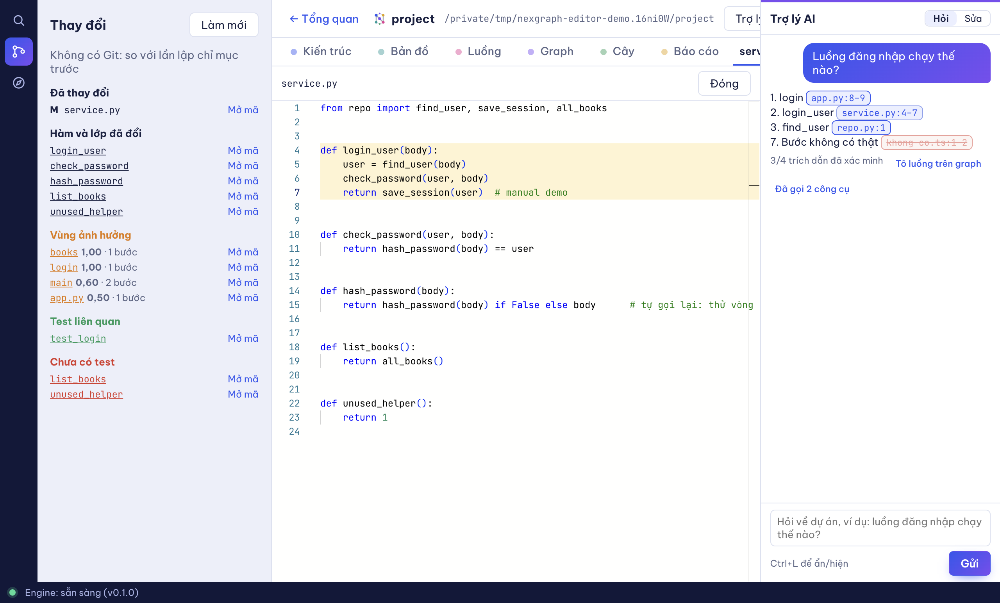

# Cài và nghiệm thu NexGraph 0.2.0-alpha.1

Bản **0.2.0-alpha.1** là bản alpha ứng viên phát hành (`v0.2.0-alpha.1`); bản đang phát hành là **0.1.2**. Bản cuối `0.2.0` dự kiến cuối 20/12/2026. Hai bản cùng là **NexGraph độc lập trên Electron, với trình soạn thảo Monaco tích hợp**. CI đóng gói engine Python cùng ứng dụng. Code-OSS đã tích hợp dưới dạng bản xem trước, có quy trình dựng và mốc nghiệm thu riêng. [Cấu hình bộ cài](../../apps/desktop/electron-builder.yml) · [Kiến trúc](../srs/architecture.md) · [Ghi chú phát hành 0.2.0-alpha.1](notes-0.2.0.md)

## Tải đúng bộ cài

Bản đã gắn tag `v<version>` có sẵn bộ cài và tệp `.build.json` ở [Releases](https://github.com/twotnguyen/nexgraph/releases). Phát hành bản mới theo [runbook phát hành](runbook.md): tăng version ở bốn tệp, merge vào `main`, rồi `git tag v<version> && git push origin v<version>`; CI kiểm, đóng gói hai hệ điều hành rồi tạo Release. Tag không khớp `version` trong `apps/desktop/package.json` thì CI dừng. Bản alpha dùng tag đúng chuỗi `v0.2.0-alpha.1` và phải đánh dấu **prerelease** trên Release (xem [runbook](runbook.md#3-tạo-tag-tình-duyệt-trước)). Commit chưa gắn tag thì lấy bộ cài từ Actions như dưới đây.

1. Mở lượt [GitHub Actions](https://github.com/twotnguyen/nexgraph/actions/workflows/ci.yml) của commit dự kiến bàn giao. Chọn cả hai bộ cài từ cùng commit đó. Ở **Artifacts**, tải gói `NexGraph-${version}-<hệ-điều-hành>-${arch}` rồi giải nén để lấy bộ cài. Chỉ dùng artifact của lượt chạy mà mọi job đều đạt: job `package` khai báo `needs: [engine, desktop]` nên chỉ chạy sau khi test engine và desktop xong, và test đỏ thì không có artifact bộ cài. Tải artifact cần đăng nhập GitHub.
2. Kiểm hệ điều hành và kiến trúc của máy, rồi đối chiếu tên tệp trong artifact. Trên Windows xem **Settings → System → About → System type**. Trên macOS xem **About This Mac** để phân biệt Apple silicon và Intel. Chỉ dùng kiến trúc có trong lượt build và khớp với máy đích.
3. Trong artifact, mở tệp cùng tên gốc với bộ cài và có đuôi `.build.json`, ví dụ `NexGraph-0.2.0-alpha.1-windows-x64.build.json`. Dùng `version`, `platform`, `arch`, `filename`, `bytes`, `sha256`, `commit` và `run` để đối chiếu tệp thực tế trước khi cài. Ghi hash và nguồn vào [biên bản nghiệm thu](acceptance/).

| Hệ điều hành | Tệp trong artifact 0.2.0-alpha.1 | Cách cài |
|---|---|---|
| Windows x64 | `NexGraph-0.2.0-alpha.1-windows-x64.exe` | Mở trình cài NSIS, chọn nơi cài, sau đó mở NexGraph từ Start. |
| macOS Apple silicon | `NexGraph-0.2.0-alpha.1-macos-arm64.dmg` | Mở ảnh đĩa, kéo NexGraph vào **Applications**, tháo ảnh đĩa rồi mở ứng dụng. |

Tên tệp lấy từ `artifactName` trong [cấu hình electron-builder](../../apps/desktop/electron-builder.yml); số byte và SHA-256 lấy từ `.build.json` của lượt đóng gói. Hai bản RC đã dựng đều mang version **0.1.2** (chưa phải bản alpha): **RC1** `main` `72dc4ec` có DMG macOS arm64 **257.676.473 byte** và là bản của [biên bản demo 23/11](acceptance/2026-11-23-macos.md) — demo 4 bước đạt cả 4 bước; **RC2** `main` `8118db0` có DMG **257.724.354 byte (257,7 MB)**, nghiệm thu bổ sung ngày 23–24/11 đạt phần lớn các dòng nhưng còn finding Important phải sửa trước khi tạo tag (xem [ghi chú phát hành](notes-0.2.0.md#bằng-chứng-nghiệm-thu-theo-bộ-cài)). Bộ cài **0.2.0-alpha.1** dựng từ tag `v0.2.0-alpha.1` chưa có; bộ cài Windows của 0.1.2 có EXE 228 MB.

Tính SHA-256 của tệp bộ cài đã giải nén bằng `Get-FileHash -Algorithm SHA256 -LiteralPath '<tệp>'` trong PowerShell hoặc `shasum -a 256 '<tệp>'` trên macOS. So hash không phân biệt chữ hoa và thường. Trường `commit` ghi đúng checkout mà runner đã dùng. Khi kiểm pull request, GitHub có thể dựng từ commit hợp nhất của lượt chạy.

Mỗi tệp cài phải dưới 500 MB; bước kiểm tệp cài trong CI báo lỗi khi vượt. Bản 0.1.0 trên macOS chiếm khoảng 650 MB sau khi kéo vào Applications; ghi lại dung lượng sau cài của 0.2.0-alpha.1 trong biên bản.

### Mở bộ cài chưa ký số

Bộ cài không có chứng chỉ nhà phát triển nên hệ điều hành cảnh báo ở lần mở đầu. Cả hai hệ điều hành đều có thể chặn trước khi trình cài hiện ra; ghi lại mã sự kiện và thông báo vào checklist.

- **macOS:** mở NexGraph, gặp thông báo không xác minh được nhà phát triển thì chọn **Done**. Vào **System Settings → Privacy & Security**, kéo xuống mục Security, chọn **Open Anyway** cạnh dòng nhắc NexGraph rồi xác nhận. Từ bản 0.1.1, app được ký ad-hoc nên đi được đường này. Bản 0.1.0 có chữ ký chưa trọn, macOS có thể báo app "bị hỏng"; khi đó chạy `xattr -dr com.apple.quarantine /Applications/NexGraph.app` trong Terminal rồi mở lại.
- **Windows — SmartScreen:** hộp thoại "Windows protected your PC" thì chọn **More info → Run anyway**.
- **Windows — Code Integrity / Application Control:** trên máy bật Windows Defender Application Control, Smart App Control hoặc chính sách chỉ cho phép tệp đã ký, trình cài chưa ký bị chặn **trước khi** hộp SmartScreen hiện ra. Lượt 18/11/2026 gặp đúng trường hợp này: `Microsoft-Windows-CodeIntegrity/Operational` ghi sự kiện **3033** và **3077**, lần thử dừng ở bước khởi chạy NSIS. Cách xử lý theo thứ tự:
  1. Kiểm **Windows Security → App & browser control → Smart App Control**; nếu đang bật, tắt bằng tài khoản quản trị (không tắt được trên máy do tổ chức quản lý).
  2. Kiểm chính sách Application Control: `Get-CIPolicy -List` hoặc `cipolicy` trong Event Viewer; máy của trường/công ty thường do người phụ trách đặt, không tự sửa.
  3. Không có quyền đổi chính sách thì ghi mã sự kiện, tên chính sách và thông báo vào [checklist](../windows-checklist.md) rồi báo người phụ trách máy; dùng bản build từ mã nguồn để tiếp tục nghiệm thu luồng người dùng.
  4. Không tự thêm chứng chỉ vào Trusted Root hay tắt toàn bộ Code Integrity trên máy không phải của mình.

Nếu hệ điều hành vẫn chặn trình cài hoặc engine đã cài, ghi rõ thành phần và thông báo trong checklist. Với máy được quản lý, báo người phụ trách máy. [Workflow và artifact](../../.github/workflows/ci.yml) · [Kiểm tên bộ cài](../../apps/desktop/scripts/check-installer.mjs) · [Biên bản 0.1.0 bị chặn](acceptance/2026-11-18.md)

## Chạy lần đầu

1. Mở NexGraph và chờ trạng thái engine sẵn sàng. Bộ cài dùng engine kèm theo. Git giúp đọc thay đổi theo HEAD. Khi dự án thiếu Git phù hợp, Changes dùng mốc lập chỉ mục.
2. Tại màn **Dự án**, chọn **Mở thư mục…** và chọn bản sao mã nguồn có dấu và khoảng trắng. Có thể chạy [fixture Python trên app đã cài](../demo-script.md#kiểm-nhanh-bằng-fixture-python) trước khi chuẩn bị bản sao NestJS.
3. Dự án nhỏ tự lập chỉ mục, dự án vượt ngưỡng hiển thị lựa chọn phạm vi. Khi hoàn tất, bấm **Bắt đầu khám phá**. Dự án đã có chỉ mục mở thẳng vào không gian làm việc. Thử **Tìm trong đồ thị** rồi vào **Kiến trúc**, chọn một quan hệ có bằng chứng và mở mã đúng dòng trong Monaco.
4. Cây tệp nằm bên trái, mã và sơ đồ ở giữa, trợ lý AI bên phải. Thử mở tệp từ cây, sửa rồi lưu bằng `Ctrl+S` hoặc `⌘S` và mở **Vùng ảnh hưởng**. Nút **← Tổng quan** mở thống kê và tùy chọn index. Phần lập chỉ mục, tìm kiếm và xem graph chạy cục bộ. Cấu hình AI khi cần kiểm Hỏi hoặc Sửa.

## Ảnh giao diện

**Màn Dự án.** Ảnh lưu từ đợt kiểm NexGraph 0.1.0 Electron trên Windows, với engine thật đã sẵn sàng. Các ảnh trong mục này ghi lại phiên bản ở thời điểm kiểm, trước lần cập nhật bố cục ba cột.

**Kiến trúc NestJS.** Ảnh chụp trên Windows từ renderer Electron 0.1.0 đã build, dùng engine phát triển và bản sao `ecommerce-backend-nestjs` tại `d11f4ef`. Đồ thị gốc hiển thị các khối và quan hệ `test → src`.

**Monaco và trợ lý.** Hai ảnh chụp bản Electron đóng gói trên macOS arm64 với fixture Python và mô hình giả lập ngày 15/11. Ảnh Hỏi minh họa trích dẫn mở đúng dòng và vùng ảnh hưởng. Ảnh Sửa minh họa diff cùng hai lựa chọn Duyệt và Từ chối. [Biên bản chụp ảnh](../benchmarks/2026-11-15-editor-agent.md#kiểm-trên-bản-đóng-gói-electron-thật)

## Bằng chứng và nghiệm thu

| Nơi kiểm | Phép thử và bằng chứng |
|---|---|
| CI trên GitHub | Windows cài NSIS vào thư mục tạm. macOS gắn DMG rồi chép app vào thư mục tạm. Smoke dùng engine đi kèm và AI giả để kiểm đường dẫn có dấu, lập chỉ mục, sửa tệp, vùng ảnh hưởng trên fixture không Git và truy vấn sau gián đoạn endpoint AI. Lưu tệp `.build.json`, dòng `SMOKE OK` có đủ `nodes=… fs=OK agent=OK index=OK edit_policy=OK acceptance=OK workspace_controls=OK sessions=OK plan=OK process=OK rollback=OK draft_context=OK gemini_status=OK gemini_ui=OK webgl_fallback=OK` và dòng `SMOKE ENGINE STOPPED pid=…`. Danh sách trường lấy từ [smoke-packaged.mjs](../../apps/desktop/scripts/smoke-packaged.mjs); `webgl_fallback=OK` chỉ có khi lượt chạy tắt WebGL. |
| Máy Windows đích | Cài bản NSIS đã đối chiếu, ghi thư mục cài và trạng thái engine. Làm checklist trên bản sao nguồn Unicode có khoảng trắng. Lưu kết quả thao tác, cảnh báo hệ điều hành, ảnh, log và tình trạng tiến trình khi thoát. |
| Máy macOS đích | Chép app từ DMG đã đối chiếu vào **Applications**, ghi kiến trúc và trạng thái engine. Làm cùng checklist trên bản sao nguồn Unicode có khoảng trắng. Lưu ảnh, log và tình trạng tiến trình khi thoát. |
| Demo NestJS | Ghi kết quả ba lượt trên bản đã cài, thời gian thực tế, kết quả Duyệt/Từ chối và thao tác dự phòng khi AI gián đoạn. Ghi provider hoặc mô hình giả được dùng. Ghi kết nối MCP riêng nếu đã thử bằng client thật. |

Trong [biên bản nghiệm thu](acceptance/), điền **Đạt**, **Lỗi** hoặc **Chưa chạy** theo từng phép thử. Việc cài và thao tác trên máy đích dùng cùng commit với artifact đã kiểm trên CI. [Checklist Windows và macOS](../windows-checklist.md) · [Kịch bản fixture và NestJS](../demo-script.md) · [Kế hoạch kiểm thử 0.2.0](test-plan.md) · [Smoke đóng gói](../../apps/desktop/scripts/smoke-packaged.mjs) · [Cài đặt từ mã nguồn](../install-notes.md).

## Bản xem trước Code-OSS

Code-OSS có editor native và dùng lại giao diện/engine NexGraph. Bản xem trước có build riêng. Khi xét chuyển thành bản chính, yêu cầu một lượt CI riêng trên Windows và macOS với engine kèm theo, mở được trên máy sạch, cùng biên bản kiểm mở đúng dòng, lập chỉ mục, refresh, duyệt AI và dọn tiến trình. Ghi riêng kết quả xuất PNG vì lớp tương thích hiện chưa hỗ trợ thao tác này. [Build Code-OSS](../../apps/shell/README.md) · [Lớp tương thích](../../apps/extension/src/electron-host.ts)
