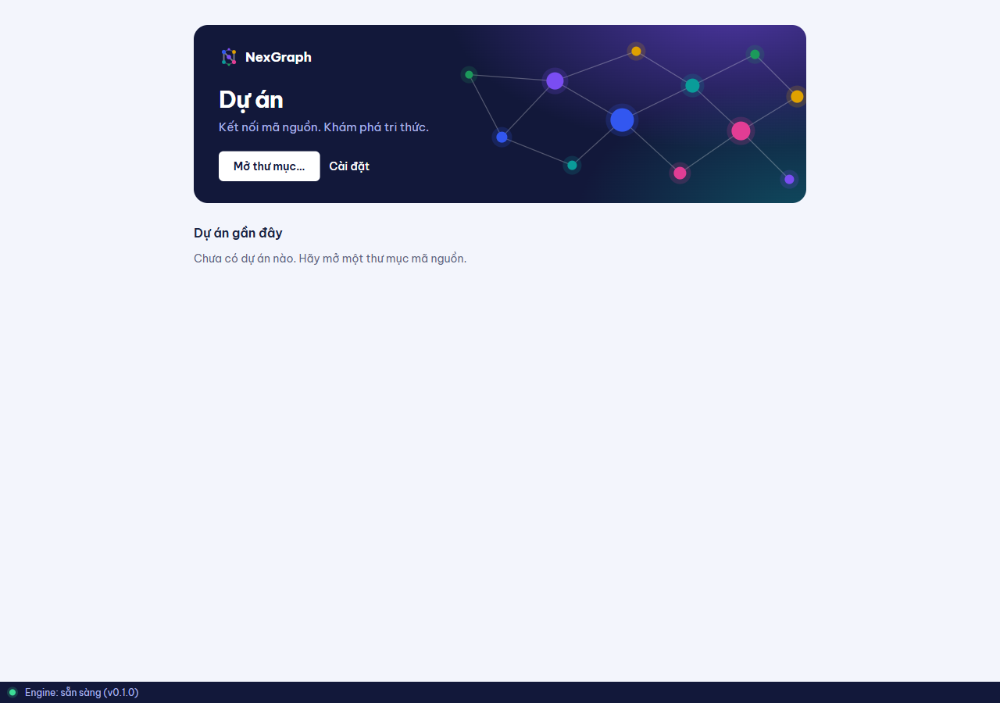
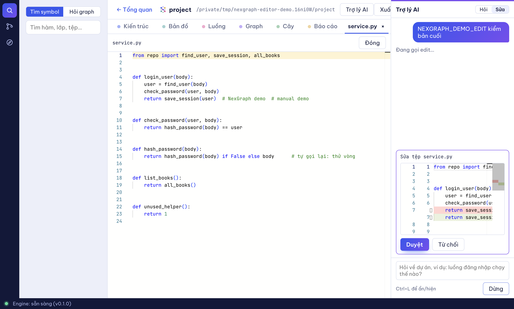

# Cài và nghiệm thu NexGraph 0.1.0

Bản bàn giao chính 0.1.0 là **NexGraph độc lập trên Electron, với trình soạn thảo Monaco tích hợp**. CI đóng gói engine Python cùng ứng dụng. Code-OSS đã tích hợp dưới dạng bản xem trước, có quy trình dựng và mốc nghiệm thu riêng. [Cấu hình bộ cài](../../apps/desktop/electron-builder.yml) · [Kiến trúc](../srs/architecture.md)

## Tải đúng bộ cài

1. Mở lượt [GitHub Actions](https://github.com/twotnguyen/nexgraph/actions/workflows/ci.yml) của commit được bàn giao. Ở **Artifacts**, tải gói `NexGraph-${version}-<hệ-điều-hành>-${arch}` rồi giải nén để lấy bộ cài. Repo private nên tài khoản tải cần có quyền đọc.
2. Kiểm hệ điều hành và kiến trúc của máy, rồi đối chiếu tên tệp trong artifact. Trên Windows xem **Settings → System → About → System type**. Trên macOS xem **About This Mac** để phân biệt Apple silicon và Intel. Chỉ dùng kiến trúc có trong lượt build và khớp với máy đích.
3. Lưu tên tệp, commit, URL lượt chạy và hash SHA-256 vào [biên bản nghiệm thu](../srs/traceability.md#biên-bản-cho-bản-bàn-giao). Khi bên bàn giao có công bố SHA-256, so khớp trước khi cài.

| Hệ điều hành | Tệp trong artifact 0.1.0 | Cách cài |
|---|---|---|
| Windows x64 | `NexGraph-0.1.0-windows-x64.exe` | Mở trình cài NSIS, chọn nơi cài, sau đó mở NexGraph từ Start. |
| macOS Apple silicon | `NexGraph-0.1.0-macos-arm64.dmg` | Mở ảnh đĩa, kéo NexGraph vào **Applications**, tháo ảnh đĩa rồi mở ứng dụng. |

CI đặt tên theo phiên bản và kiến trúc của lượt build. Có thể tính SHA-256 bằng `Get-FileHash -Algorithm SHA256 <tệp>` trong PowerShell hoặc `shasum -a 256 <tệp>` trên macOS. Bản dựng hiện dùng cấu hình chưa ký số. Nếu hệ điều hành cảnh báo, kiểm lại nguồn artifact và ghi kết quả vào checklist. Nếu máy quản lý chặn cài, báo người phụ trách máy để xử lý theo quy định tại máy đó. [Workflow và artifact](../../.github/workflows/ci.yml) · [Kiểm tên bộ cài](../../apps/desktop/scripts/check-installer.mjs) · [Ghi chú cài đặt](../install-notes.md)

## Chạy lần đầu

1. Mở NexGraph và chờ trạng thái engine sẵn sàng. Bộ cài dùng engine kèm theo. Git giúp đọc thay đổi theo HEAD. Khi dự án thiếu Git phù hợp, Changes dùng mốc lập chỉ mục.
2. Tại màn **Dự án**, chọn **Mở thư mục…** và chọn bản sao mã nguồn. Có thể dùng [fixture Python ngắn](../demo-script.md#kiểm-nhanh-bằng-fixture-python) để thử trước, rồi chạy demo NestJS.
3. Chọn phạm vi và lập chỉ mục. Khi hoàn tất, mở **Tổng quan** hoặc **Kiến trúc**, chọn quan hệ có bằng chứng rồi mở mã đúng dòng trong Monaco.
4. Thử sửa một tệp trong bản sao, lưu rồi mở **Thay đổi**. Phần lập chỉ mục, tìm kiếm và xem graph chạy cục bộ. Cấu hình AI khi cần kiểm Hỏi hoặc Sửa.

## Ảnh giao diện

**Màn Dự án.** Ảnh chụp NexGraph 0.1.0 Electron chạy từ mã nguồn trên Windows, với engine thật đã sẵn sàng.

**Monaco và trợ lý.** Hai ảnh chụp bản Electron đóng gói trên macOS arm64 với fixture Python và mô hình giả lập. Ảnh Hỏi minh họa trích dẫn mở đúng dòng và vùng ảnh hưởng. Ảnh Sửa minh họa diff cùng hai lựa chọn Duyệt và Từ chối. [Biên bản chụp ảnh](../benchmarks/2026-11-15-editor-agent.md#kiểm-trên-bản-đóng-gói-electron-thật)

## Bằng chứng và nghiệm thu

Smoke đóng gói chạy app Electron đã giải nén với engine thật và LLM giả cục bộ. Điều kiện của phép thử là có `SMOKE OK` cùng `fs=OK agent=OK`. Kết quả máy đích cần ghi riêng khi cài tệp NSIS/DMG. Dùng bản cài đúng commit và ghi **Đạt**, **Lỗi** hoặc **Chưa chạy** cho từng phép thử.

| Phép thử | Kết quả cần ghi |
|---|---|
| Build và smoke | Windows/macOS, kiến trúc, tên artifact, commit, lượt CI và dòng kết quả. Dùng log của lượt thực tế. |
| Cài trên máy đích | Mở app từ bộ cài, engine sẵn sàng, index bản sao có đường dẫn chứa dấu và khoảng trắng, mở bằng chứng. Ghi cảnh báo và xác nhận thoát app sạch. |
| Demo và AI | Ba lượt NestJS, thời gian từng lượt. Kiểm Hỏi/Sửa, Duyệt/Từ chối/Dừng với provider dự định trình diễn và một truy vấn MCP từ client thật. Ghi rõ provider giả hay thật. |

Phạm vi 0.1.0 ở đây chốt dạng bàn giao và quy trình đọc bằng chứng. Hướng dẫn dựng lặp lại và biên bản nghiệm thu thủ công đầy đủ là các đợt tiếp theo. Kết quả Electron với fixture và provider giả lập được lưu trong báo cáo riêng. [Smoke đóng gói](../../apps/desktop/scripts/smoke-packaged.mjs) · [Checklist Windows](../windows-checklist.md) · [Kịch bản NestJS](../demo-script.md) · [Báo cáo editor và agent](../benchmarks/2026-11-15-editor-agent.md)

## Bản xem trước Code-OSS

Code-OSS có editor native và dùng lại giao diện/engine NexGraph. Bản xem trước có build riêng. Khi xét chuyển thành bản chính, yêu cầu một lượt CI riêng trên Windows và macOS với engine kèm theo, mở được trên máy sạch, cùng biên bản kiểm mở đúng dòng, lập chỉ mục, refresh, duyệt AI và dọn tiến trình. Ghi riêng kết quả xuất PNG vì lớp tương thích hiện chưa hỗ trợ thao tác này. [Build Code-OSS](../../apps/shell/README.md) · [Lớp tương thích](../../apps/extension/src/electron-host.ts)
