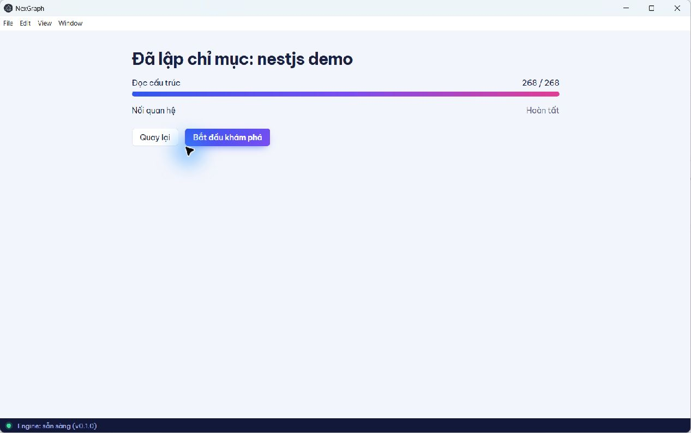

# Biên bản nghiệm thu NexGraph 0.1.0 — 18/11/2026

| Lượt | Môi trường | Kết quả |
| --- | --- | --- |
| Cài bộ cài Windows trên máy đích | Windows 11 Home Single Language x64 25H2, build 26200.9711 | **Bị chặn** khi khởi chạy NSIS. |
| Thao tác NestJS trên máy Windows đích | Electron 44.9.3 từ bản build mã nguồn tại `f763f9a`, engine Python phát triển, hồ sơ NexGraph riêng | **Đạt** cho luồng chính. Phát hiện nút tắt trợ lý bị khuất khi mở đồng thời ngăn Thay đổi và trợ lý. |
| Smoke hai bộ cài trên GitHub Actions | NSIS Windows x64 và DMG macOS arm64 | Ghi nhận kết quả của commit hợp nhất ở báo cáo kiểm thử trên PR Nhóm 8. |
| Cài và thao tác trên máy macOS đích | Máy macOS của nhóm | **Chưa chạy**. |

Máy thử Windows dùng AMD Ryzen 5 5500U, RAM khả dụng 7,3 GB, AMD Radeon và NVIDIA GTX 1650. [Checklist hai hệ điều hành](../../windows-checklist.md)

## Thử bộ cài trên máy Windows đích

- Lấy `NexGraph-0.1.0-windows-x64.exe` từ artifact của Nhóm 7. Lượt này đóng gói commit hợp nhất `d6befdbd8eddd9dac37081ff4cc8881ae0d2bc92` từ nhánh Nhóm 7 tại `f763f9ab123228261bf1c5c98c957dafe38ded71`. [Lượt CI Nhóm 7](https://github.com/twotnguyen/nexgraph/actions/runs/44197953925) · [Artifact Windows](https://github.com/twotnguyen/nexgraph/actions/runs/44197953925/artifacts/14379694056)
- Tệp EXE 222.491.046 byte. SHA-256 `04951aff9b76d7a3c77438d0bc5cab3e7f844814da733827f17c22a819de64c5`. SHA-256 của ZIP tải xuống khớp metadata artifact trên GitHub.
- Thử cài NSIS theo tài khoản hiện tại vào thư mục thử. Windows Code Integrity từ chối thực thi tệp EXE chưa ký trước khi trình cài mở. Nhật ký `Microsoft-Windows-CodeIntegrity/Operational` ghi sự kiện 3033 và 3077 lúc 06:39:35 theo giờ địa phương. Lần thử dừng tại bước khởi chạy trình cài.

Để tiếp tục nghiệm thu bộ cài trên máy này, dùng gói mà chính sách Code Integrity chấp nhận. Ghi lại commit và SHA-256 của tệp thực tế được thử. [Hướng dẫn chọn và cài bộ cài](../README.md#tải-đúng-bộ-cài)

## Thao tác trực tiếp trên máy Windows

Mở bản sao Git của `ecommerce-backend-nestjs` tại `d11f4ef7d906ba514cf9e3c2234116ad49789ee7` trong thư mục `Đồ án/nestjs demo`. Lần quan sát đầu ở giây 8 thấy tiến độ đã xác định tổng 268 tệp. Lần quan sát ở giây 50 sau khi đóng hộp chọn thư mục thấy lập chỉ mục đã hoàn tất.

| Phép thử | Kết quả đã quan sát |
| --- | --- |
| Mở dự án và lập chỉ mục | Hộp chọn thư mục Windows nhận đường dẫn tiếng Việt có khoảng trắng. App lập chỉ mục 268/268 tệp. |
| Kiến trúc, bằng chứng và Monaco | Quan hệ `test → src` có bằng chứng tại `test/app.e2e-spec.ts:12`. Bấm bằng chứng mở Monaco tại dòng 12. |
| Tìm kiếm và Luồng | `signIn` trả controller ở dòng 24 và service ở dòng 111. Monaco mở đúng vùng bắt đầu tại dòng 111. Route đăng nhập hiển thị 8 bước qua 4 tệp. |
| Lưu và vùng ảnh hưởng | Thêm một comment vào `AuthService.signIn` rồi Ctrl+S. Git thấy đúng một dòng thay trong `auth.service.ts`. Thẻ Thay đổi so với HEAD hiển thị `AuthController.signIn` cách một bước. |
| Bản đồ và hồ sơ AI mới | Bản đồ vẽ 268 nút cho 268 tệp. Bật trợ lý báo chưa cấu hình AI, vẫn hiển thị đồ thị. Nút tắt bị khuất ở cửa sổ khoảng 1280 px khi ngăn Thay đổi đang mở. |
| Thoát app | App thoát với mã 0. PID của Electron, uv và hai tiến trình Python của lượt này đều đã biến mất. |



Sau khi sửa thanh tiêu đề, mở fixture Python bốn tệp trong một thư mục dài có dấu và khoảng trắng. **Thay đổi** báo so với lần lập chỉ mục trước. Khi ngăn này đang mở, thao tác bật và tắt **Trợ lý AI** đều thực hiện được. Khi tắt WebGL, **Bản đồ** hiện thông báo chuyển sang **Kiến trúc** và đồ thị ở thẻ Kiến trúc vẫn được vẽ.

Smoke trên renderer Nhóm 8 với engine phát triển kiểm thêm nút **Xuất**, cùng việc tra đồ thị sau khi ngắt riêng kết nối AI giả lập.

```text
SMOKE OK nodes=2 fs=OK agent=OK index=OK edit_policy=OK acceptance=OK workspace_controls=OK webgl_fallback=OK
SMOKE ENGINE STOPPED pid=13516
```

## Điều kiện bàn giao còn chờ

- Chạy đủ checklist trên Windows và macOS từ chính NSIS và DMG của cùng một lượt phát hành. Ghi đường dẫn cài, hash, log, ảnh, kết quả thoát và các mục lỗi theo từng máy.
- Diễn tập ba lượt trên bản đã cài với repo demo của nhóm. Ghi riêng lượt bình thường, duyệt hoặc từ chối diff và gián đoạn kết nối AI. [Kịch bản demo](../../demo-script.md#nghiệm-thu)
