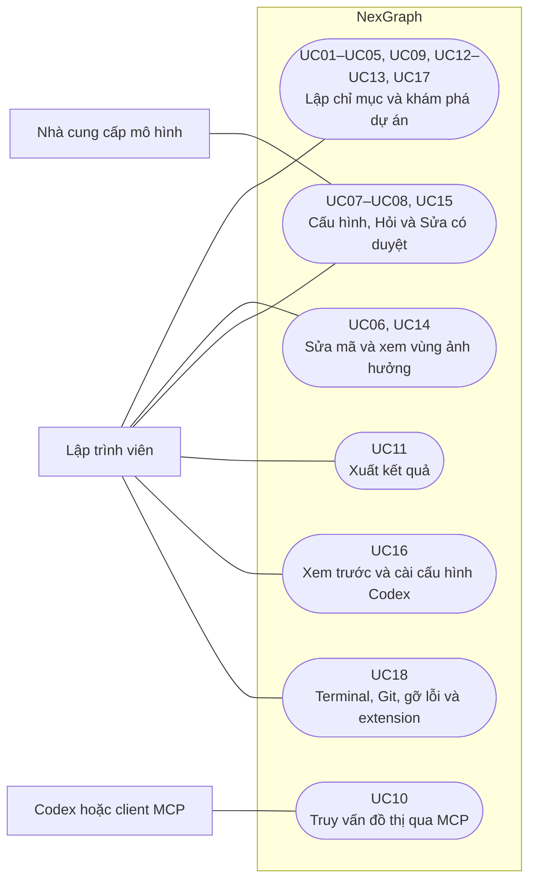

# Đặc tả yêu cầu phần mềm NexGraph

Đặc tả này mô tả phạm vi bàn giao NexGraph 0.1.2 và bản ứng viên 0.2.0 dựa trên các yêu cầu đã điều chỉnh ở tuần 5. Dùng tài liệu này cùng [ma trận truy vết](traceability.md) để phát triển và nghiệm thu. Mỗi yêu cầu tách tiêu chí cần đạt khỏi bằng chứng đã có. Các bản thiết kế theo tuần trước đó được giữ trong [kho lưu trữ](../superpowers/).

## Mục tiêu và đối tượng

- **Đọc hiểu dự án lạ.** Lập trình viên tìm được định nghĩa, lần từ kiến trúc đến tệp và đọc luồng thực thi có chứng cứ trong mã.
- **Đánh giá thay đổi.** Người đang sửa mã tìm được phần phụ thuộc bị ảnh hưởng và các bài kiểm thử liên quan mà phân tích tĩnh nhận diện được.
- **Cung cấp ngữ cảnh cho AI.** Trợ lý trong app và client MCP tra cứu đồ thị theo phạm vi dự án. Người dùng kiểm chứng được vị trí trích dẫn và xem trước thao tác ghi do AI đề xuất.

## Phạm vi và cách triển khai

| Hạng mục | Phạm vi |
|---|---|
| Nền tảng | Bản phát hành hiện hành 0.1.2 và bản ứng viên 0.2.0 là Electron độc lập với Monaco tích hợp, cho **macOS Apple silicon (arm64) và Windows x64**; Mac Intel và Windows ARM ngoài phạm vi. Repo và bộ cài công khai ở [GitHub Releases](https://github.com/twotnguyen/nexgraph/releases). Người dùng chọn đúng kiến trúc theo [bộ cài](../release/README.md). [Code-OSS](../../labs/shell/README.md) được giữ ở mức bản xem trước tích hợp, dùng editor của workbench và có phép nghiệm thu riêng. |
| Ngôn ngữ MVP | TypeScript, JavaScript và Python. Đánh giá trên ca sử dụng thực tế và báo giới hạn phân tích tĩnh. |
| Ngôn ngữ bổ sung | C# và Dart có bộ trích xuất trong engine. Go và Java ở mức đồ thị chung. Cây widget, route và phân tích Flutter chuyên sâu thuộc hướng phát triển. Bảng [phần mở rộng thực tế](../../engine/src/nexgraph_engine/index/discovery.py) là tham chiếu khi cập nhật mức hỗ trợ. |
| Phạm vi đồ thị | Một thư mục dự án mỗi lần phân tích, có thể giới hạn ở thư mục con và loại trừ đường dẫn. Dùng Git khi có commit phù hợp, nếu thiếu thì dùng mốc lập chỉ mục. |
| Dịch vụ AI | Luồng kiểm chính sử dụng API key hoặc nhà cung cấp tùy chỉnh tương thích. OAuth khả dụng theo cấu hình nhưng cần nghiệm thu riêng. Phiên chat lưu dạng JSONL trong thư mục dữ liệu của app, tách theo dự án và tài khoản (ADR 0021). |
| Hướng mở rộng | Ứng dụng web, máy chủ hoặc tài khoản NexGraph, clone repo qua URL và phân tích liên kho hoặc liên dịch vụ. |

## Yêu cầu chức năng

Chi tiết thao tác, lỗi và bằng chứng theo từng mục có trong [ma trận truy vết](traceability.md). Điều kiện cần xác nhận trên bản cài được ghi trong [kịch bản demo](../demo-script.md) và [checklist Windows](../windows-checklist.md).

Theo phạm vi tuần 5, nhóm xếp F1–F4, F6, F8, F10 và F11 là bắt buộc cho đồ án. F5, F7 và F12 là nhóm nên có, F9 là nhóm có thể có. F13–F16 là các chức năng được bổ sung sau: luồng sửa mã và tích hợp trợ lý (F13–F15) và bộ công cụ phát triển kiểu Wu (F16), có use case và tiêu chí nghiệm thu riêng.

| Mã | Chức năng | Kết quả người dùng cần nhận được |
|---|---|---|
| F1 | Mở dự án và lập chỉ mục | Quét sơ bộ, chọn phạm vi, hiển thị tiến độ, hủy được và mở lại chỉ mục đã có. |
| F2 | Kiến trúc | Xem các khối, đi sâu và mở bằng chứng tệp:dòng của quan hệ giữa khối. |
| F3 | Graph và xem mã | Duyệt nút lân cận, xem loại quan hệ, nguồn và mở vị trí mã liên quan. |
| F4 | Tìm kiếm | Tìm theo ký hiệu hoặc từ khóa. Hỏi đồ thị cục bộ trả về các nút, quan hệ và giới hạn kết quả. |
| F5 | Hỏi AI có trích dẫn | Hỏi về dự án, kiểm tra vị trí trích dẫn và mở mã hoặc tô lộ trình theo các cạnh thật. |
| F6 | Thay đổi và vùng ảnh hưởng | Nhận diện thay đổi, lần quan hệ phụ thuộc, xem test liên quan và phạm vi dữ liệu đã phân tích. |
| F7 | Tham quan | Sinh lộ trình đọc từ đồ thị để người mới đi qua điểm vào và thành phần quan trọng. |
| F8 | MCP | Client truy vấn một dự án qua stdio hoặc Streamable HTTP cục bộ có khóa. |
| F9 | Xuất đồ thị | Chọn phạm vi và định dạng mà host hỗ trợ, nhận kết quả và thông báo nếu dữ liệu bị giới hạn. |
| F10 | Tổng quan, báo cáo và tài liệu | Xem thống kê và báo cáo. Khi bật tùy chọn, lập chỉ mục tài liệu cục bộ theo định dạng được hỗ trợ. Bản chép lời media phụ thuộc công cụ tùy chọn. |
| F11 | Luồng | Tìm điểm vào, phát từng bước, xem caller và mở mã từ cạnh lời gọi có bằng chứng. |
| F12 | Bản đồ toàn cảnh | Xem đồ thị cấp tệp/khối, đi sâu theo phạm vi và dùng thẻ Kiến trúc khi WebGL không khả dụng. |
| F13 | Trình soạn thảo | Mở đúng vị trí, sửa/lưu và xử lý tệp thay đổi bên ngoài, giữ nội dung chưa lưu. |
| F14 | Agent Hỏi, Kế hoạch và Sửa có duyệt | Hỏi và Kế hoạch chỉ dùng công cụ đọc; Sửa hiển thị diff, chờ duyệt từng đề xuất tạo hoặc chỉnh sửa tệp, có checkpoint và cho phép dừng lượt. Chạy lệnh build/test chỉ ở chế độ Sửa, khi bật công tắc riêng, và mỗi lệnh phải duyệt riêng (ADR 0016). |
| F15 | Tích hợp Codex | Xem trước cấu hình MCP và skill cấp dự án, áp dụng sau khi người dùng xác nhận và giữ cấu hình hiện có. |
| F16 | Bộ công cụ phát triển kiểu Wu | Editor có LSP TypeScript/Python, terminal tích hợp, giao diện Git (nhánh, lịch sử, hunk, stash, worktree), gỡ lỗi DAP Node/Python, cộng tác LAN và extension khai báo theme/lệnh. Chi tiết và giới hạn ở [UC18](use-cases/UC18.md); ngoại lệ so với non-goals §1.3 của spec, ghi ở ADR 0020. |

### Tác nhân và ca sử dụng

## Yêu cầu phi chức năng

### Độ tin cậy và an toàn dữ liệu

- Cạnh quan hệ dùng để giải thích phải có căn cứ từ cây cú pháp hoặc bộ phân giải. Khi graph chưa xong, đã cũ hoặc kết quả bị cắt, ứng dụng cần hiển thị giới hạn tương ứng.
- **Tiêu chí cần nghiệm thu cho bản bàn giao:** hủy hoặc lỗi khi dựng lại giữ được bản đồ thị hoàn tất gần nhất. Sau khi chạy lại, dữ liệu phải nhất quán giữa UI, API và MCP. Xem [luồng hiện tại và điểm cần kiểm](architecture.md).
- Chế độ Hỏi và Kế hoạch chỉ có công cụ đọc và truy vấn đồ thị. Chế độ Sửa yêu cầu duyệt từng thao tác `edit` hoặc `write`, kiểm tra lại trạng thái tệp trước khi ghi và từ chối bản xem trước đã cũ. Chạy lệnh build/test chỉ ở chế độ Sửa, khi bật công tắc riêng, và mỗi lệnh phải duyệt riêng (ADR 0016).
- Khi dịch vụ AI gặp lỗi, người dùng vẫn mở được chỉ mục cục bộ, tìm kiếm, đọc kiến trúc và xem luồng.

### Bảo mật và riêng tư

- File mã nguồn của dự án chỉ thay đổi khi người dùng lưu trong trình soạn thảo hoặc duyệt thao tác ghi của trợ lý AI ở chế độ Sửa. Dữ liệu của NexGraph nằm trong `.nexgraph/` của dự án và thư mục dữ liệu của ứng dụng.
- API engine nghe tại `127.0.0.1` và yêu cầu Bearer token. MCP HTTP dùng khóa riêng. Cấu hình xuất/chia sẻ cần giải thích phạm vi dữ liệu có thể đọc.
- Luồng gửi mã cho AI yêu cầu đồng ý theo dự án và điểm đến. Mục tiêu nghiệm thu gồm kiểm tệp nhạy cảm, đổi provider, đổi workspace và loại khóa/token khỏi log.
- API key dùng cơ chế bảo vệ bí mật của host. Lưu trữ OAuth và lịch sử phiên được mô tả theo mã nguồn trong [mô hình dữ liệu](data-model.md).
- Trích dẫn hợp lệ về kỹ thuật chỉ xác nhận được vị trí tương ứng. Nội dung câu trả lời vẫn phải đối chiếu với mã và đồ thị. Giao diện cần phân biệt trích dẫn chưa xác minh.

### Hiệu năng và khả dụng

| Tình huống | Tiêu chí |
|---|---|
| Dự án nhỏ đến 1.000 tệp | Mục tiêu đã đặt là lập chỉ mục dưới 60 giây, mở lại dưới 3 giây. Đo đầu cuối trên bản cài từ lúc mở đến khi có thể dùng đồ thị. |
| Dự án lớn (5.000–15.000 tệp) | Mục tiêu đo là lập chỉ mục lần đầu trong 10 phút, mở lại dưới 5 giây, cập nhật sau khi lưu dưới 2 giây với lần sửa không đổi quan hệ giữa các tệp (sửa làm đổi quan hệ thì đo và báo cáo), bộ nhớ dưới 2 GB tính cả cây tiến trình (engine và tiến trình con lập chỉ mục). Báo cáo số thực đo và cấu hình máy. Đây là mục tiêu đánh giá, không phải cam kết đã đạt. |
| Dự án rất lớn (trên 15.000 tệp) | Không đặt mục tiêu. Đo và báo cáo thời gian lập chỉ mục, cập nhật và bộ nhớ cả cây tiến trình. |
| Giao diện và đường dẫn | Tiếng Việt là giao diện hiện hành. Thử bàn phím, kích thước cửa sổ, đường dẫn có dấu/khoảng trắng và phương án thay thế khi WebGL không khả dụng. |
| Đóng gói | Bộ cài Electron theo phiên bản và kiến trúc cần mở được, khởi động engine đi kèm trên máy Windows/macOS. Mỗi tệp cài (`.dmg`, `.exe`) dưới 500 MB, CI báo lỗi khi vượt. Ghi tên artifact, commit, kiến trúc, dung lượng bộ cài và dung lượng sau khi cài, cùng kết quả. Bộ cài chưa ký số, [hướng dẫn phát hành](../release/README.md) chỉ cách mở qua cảnh báo hệ điều hành. Smoke CI và kiểm cài trên máy đích có biên bản riêng. |

Kết quả đo hiện hành cho ba tầng nằm ở [số đo 23/11/2026](../benchmarks/2026-11-23-nfr-va-do-lai.md) (một bộ số duy nhất, kèm commit và điều kiện đo). Các báo cáo [thực nghiệm H6](../benchmarks/2026-12-danh-gia.md) và [đợt tối ưu sau review](../benchmarks/2026-11-13-sua-sau-review.md) là số lịch sử, dùng phiên bản và điều kiện khác nhau. Ghi phiên bản, host, phiên bản hệ điều hành và dữ liệu thử cho từng phép đo nghiệm thu mới.

## Điều kiện nghiệm thu

1. Với [bản cài Electron 0.1.2](../release/README.md), chạy mạch mở dự án → kiến trúc/tìm kiếm → luồng → mở mã trong Monaco → sửa → xem ảnh hưởng và test liên quan.
2. Kiểm luồng lỗi trên bản cài gồm chưa cấu hình AI, mất mạng, không có Git, dự án lớn chọn thư mục con và ngôn ngữ ở mức đồ thị chung.
3. Kiểm AI Hỏi/Kế hoạch/Sửa bằng provider sẽ trình diễn, gồm mở trích dẫn, Duyệt, Từ chối và Dừng. Trên Windows và macOS, dùng provider giả để kiểm Hỏi và Kế hoạch không có công cụ chạy lệnh, còn Sửa chỉ chạy lệnh khi bật công tắc và mỗi lệnh hiện thẻ duyệt riêng. Kiểm MCP bằng client thật.
4. Chạy ba lượt [kịch bản bảo vệ](../demo-script.md), ghi thời gian và tình huống dự phòng. Duyệt lại nhãn đồ thị, đánh giá có/không MCP và khảo sát người dùng theo [kế hoạch thực nghiệm](../benchmarks/2026-12-danh-gia.md).

Xem [kiến trúc](architecture.md), [mô hình dữ liệu](data-model.md) và [ma trận truy vết](traceability.md) để xác định đường chạy, hợp đồng và bằng chứng cho từng chức năng.
