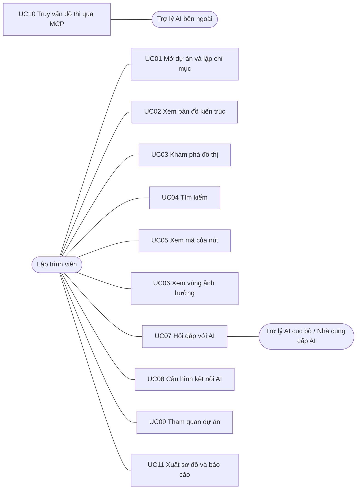

# NexGraph — Đặc tả yêu cầu phần mềm (SRS)

> Khung SRS của kế hoạch con 1. Nội dung lấy từ spec (`docs/superpowers/specs/2026-10-18-nexgraph-desktop-design.md`) và phân tích chức năng tuần 2. Các mục có số liệu chép nguyên văn từ spec; khi spec đổi thì sửa spec trước rồi cập nhật file này.

## 1. Giới thiệu

### 1.1 Mục đích
Mô tả yêu cầu của NexGraph, ứng dụng desktop (macOS và Windows) biến một thư mục mã nguồn thành đồ thị tri thức để khám phá kiến trúc, tìm kiếm, xem vùng ảnh hưởng khi sửa mã và hỏi đáp với trợ lý AI chỉ đọc. Tài liệu dùng cho nhóm phát triển, giảng viên hướng dẫn và hội đồng.

### 1.2 Phạm vi
- **Làm:** lập chỉ mục dự án mở từ thư mục cục bộ, bản đồ kiến trúc, khám phá đồ thị, tìm kiếm, vùng ảnh hưởng và test liên quan, hỏi đáp AI có trích dẫn kiểm chứng, máy chủ MCP, hiểu sâu Flutter/Dart, tham quan dự án, xuất kết quả.
- **Không làm:** clone từ URL GitHub; AI sửa mã hay chạy lệnh; ứng dụng web; máy chủ hay tài khoản của NexGraph; quan hệ giữa nhiều kho hay nhiều dịch vụ; quản lý trạng thái Flutter (Provider, Riverpod, BLoC). Chỉ Dart/Flutter bắt buộc trước demo (spec §1.3).

### 1.3 Thuật ngữ
Dùng đúng tên gọi trong `GLOSSARY.md` của workspace đồ án. Các từ chính: nút (node), cạnh (edge), bằng chứng (evidence), lập chỉ mục (index), engine, vùng ảnh hưởng (impact), test gap, ACP, MCP.

## 2. Mô tả tổng quan

### 2.1 Người dùng và tác nhân
- **Người dùng chính:** lập trình viên mới vào một dự án lạ (onboarding).
- **Người dùng phụ:** lập trình viên đang sửa mã, cần biết vùng ảnh hưởng.
- **Tác nhân ngoài:** trợ lý AI cục bộ qua ACP; nhà cung cấp AI qua khóa API; trợ lý AI bên ngoài truy vấn đồ thị qua MCP.

### 2.2 Môi trường
macOS và Windows, cả hai bắt buộc. Ứng dụng Electron + React; engine Python chạy như tiến trình con, giao tiếp qua HTTP `127.0.0.1` kèm token. Mọi chức năng lõi chạy không cần AI. Một người dùng, một máy, không tài khoản.

### 2.3 Ràng buộc
| Ràng buộc | Giá trị |
|---|---|
| Thời gian | 10 tuần theo thông báo của khoa (12/10/2026 đến 20/12/2026); nộp LMS 21–27/12/2026; bảo vệ 28/12/2026–10/01/2027 |
| Nhóm | 3 người |
| Giấy phép | Apache-2.0, repo công khai |
| Ngôn ngữ phân tích | Dart/Flutter ưu tiên 1 (MVP, demo); ưu tiên 2: TypeScript/JavaScript, C#, Python; ưu tiên 3: HTML/CSS |
| Quyền riêng tư | Không telemetry; code chỉ rời máy qua tính năng AI và có thông báo; ứng dụng không sửa tệp mã nguồn, chỉ ghi `.nexgraph/` |

## 3. Yêu cầu chức năng

| Mức | Mã | Chức năng | Use case |
|---|---|---|---|
| Bắt buộc | F1 | Mở thư mục, lập chỉ mục có tiến độ, tự cập nhật khi tệp đổi | UC01 |
| Bắt buộc | F2 | Bản đồ kiến trúc theo module/cộng đồng; mỗi mũi tên có bằng chứng | UC02 |
| Bắt buộc | F3 | Khám phá đồ thị: phóng, lọc, thẻ thông tin nút, mở mã đúng dòng | UC03, UC05 |
| Bắt buộc | F4 | Tìm kiếm ký hiệu và từ khóa | UC04 |
| Bắt buộc | F6 | Theo dõi Git working tree: vùng ảnh hưởng và test liên quan | UC06 |
| Bắt buộc | F8 | Máy chủ MCP cục bộ, cầu nối AI và đồ thị | UC07, UC10 |
| Bắt buộc | FL | Hiểu Flutter: cây widget, route giữa màn hình, phụ thuộc `pubspec.yaml` | UC02, UC03 |
| Nên có | F5 | Hỏi đáp AI có trích dẫn tệp:dòng | UC07, UC08 |
| Nên có | F7 | Tham quan dự án cho người mới (tất định, không cần AI) | UC09 |
| Có thể có | F9 | Xuất PNG, Markdown, JSON | UC11 |

Thứ tự cắt khi trễ: F9, rồi F7, rồi F5 chỉ giữ adapter khóa API.

### 3.1 Danh sách use case
| Use case | Tên | Chức năng | Người phụ trách |
|---|---|---|---|
| [UC01](use-cases/UC01.md) | Mở dự án và lập chỉ mục | F1 | P2 |
| [UC02](use-cases/UC02.md) | Xem bản đồ kiến trúc | F2, FL | P2 |
| [UC03](use-cases/UC03.md) | Khám phá đồ thị | F3, FL | P2 |
| [UC04](use-cases/UC04.md) | Tìm kiếm | F4 | P1 |
| [UC05](use-cases/UC05.md) | Xem mã của nút | F3 | P2 |
| [UC06](use-cases/UC06.md) | Xem vùng ảnh hưởng khi sửa mã | F6 | P1 |
| [UC07](use-cases/UC07.md) | Hỏi đáp với trợ lý AI | F5, F8 | P3 |
| [UC08](use-cases/UC08.md) | Cấu hình kết nối AI | F5 | P3 |
| [UC09](use-cases/UC09.md) | Tham quan dự án | F7 | P3 |
| [UC10](use-cases/UC10.md) | Truy vấn đồ thị qua MCP | F8 | P3 |
| [UC11](use-cases/UC11.md) | Xuất sơ đồ và báo cáo | F9 | P1 |

## 4. Yêu cầu phi chức năng

### 4.1 Hiệu năng
| Tầng | Ví dụ | Mục tiêu | Cam kết |
|---|---|---|---|
| S (≤ 1.000 tệp) | Project Flutter của lớp | Lập chỉ mục lần đầu < 60 s; mở lại < 3 s | Bắt buộc; demo trên tầng này |
| L (5.000–15.000 tệp) | Dự án lớn mã nguồn mở | Lập chỉ mục lần đầu ≤ 10 phút; mở lại < 5 s; cập nhật sau khi lưu tệp < 2 s; RAM < 2 GB | Đo và báo cáo trung thực ở tuần 8, không cam kết đạt |

Chung: giao diện mượt với tối đa khoảng 2.000 nút hiển thị; bộ cài < 300 MB; đo trên laptop sinh viên, ghi lại cấu hình máy đo.

### 4.2 Bảo mật và riêng tư
- Không telemetry.
- Engine chỉ nghe `127.0.0.1` và yêu cầu token; token chỉ truyền qua biến môi trường, không qua tham số dòng lệnh.
- Khóa API nằm trong kho khóa của hệ điều hành.
- Không sửa tệp mã nguồn của dự án; chỉ ghi vào `.nexgraph/`.
- Mã chỉ rời máy qua tính năng AI, có thông báo trước lần gửi đầu tiên của mỗi dự án và cho xem nội dung đã gửi.
- AI chỉ đọc; trích dẫn không kiểm chứng được bị gạch và gắn nhãn "chưa xác minh".

### 4.3 Xử lý lỗi khi demo
1. Không có trợ lý hoặc khóa API: mọi chức năng trừ chat chạy bình thường, có hướng dẫn cấu hình.
2. Dự án quá lớn: cảnh báo, cho hủy hoặc chọn thư mục con.
3. Dự án không phải Flutter: đồ thị chung vẫn chạy, thẻ Flutter ẩn hoặc báo trống.
4. Mất mạng lúc demo: dự án đã lập chỉ mục sẵn và video dự phòng.
5. Dự án không phải Git: vẫn mở; vùng ảnh hưởng so với lần lập chỉ mục trước.

Cả 5 kịch bản có ca kiểm thử trong test plan.

### 4.4 Khả dụng
Giao diện song ngữ Việt/Anh, mặc định tiếng Việt, thuật ngữ kỹ thuật giữ tiếng Anh.

## 5. Sơ đồ use case

Sơ đồ use case chi tiết (include, extend) ở `design/diagrams/uml-usecase.html`.

## 6. Phụ lục

- Thiết kế: `docs/superpowers/specs/2026-10-18-nexgraph-desktop-design.md`.
- Phân tích chức năng, truy vết use case sang thiết kế và dữ liệu: `docs/superpowers/specs/2026-10-24-nexgraph-phan-tich-chuc-nang.md`.
- CSDL: `docs/superpowers/specs/2026-10-24-nexgraph-csdl-*.md`, script `design/database/`.
- Mockup giao diện: `design/mockups/`.
- Hợp đồng API engine v1: `docs/superpowers/plans/2026-10-18-nexgraph-roadmap.md`.
