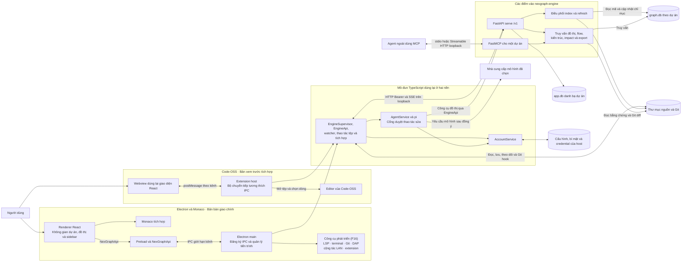
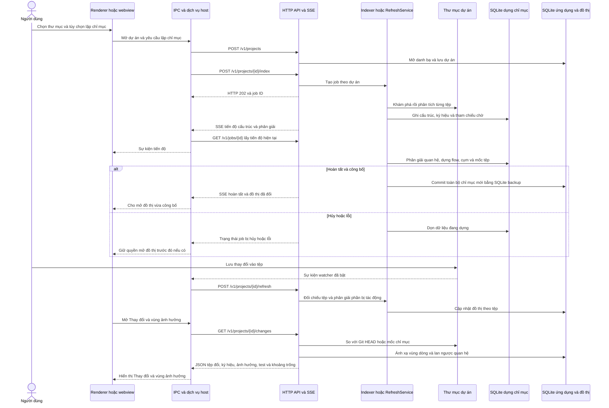
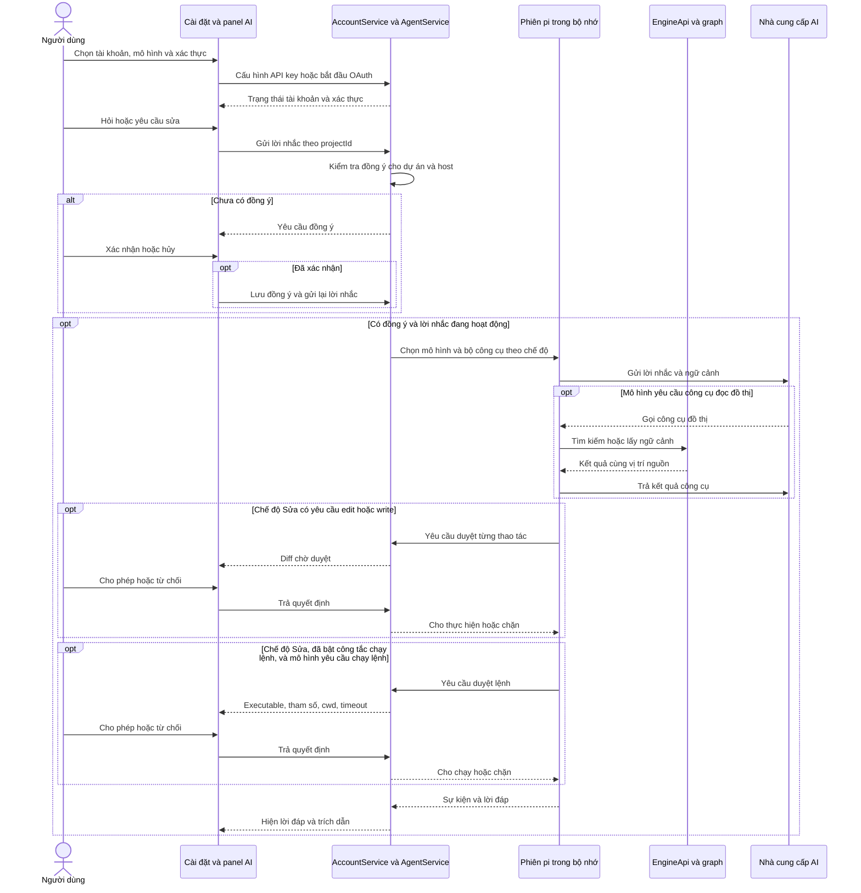

# Kiến trúc NexGraph

Tài liệu mô tả mã tại mốc `c00c0fb` (origin/main, 23/11/2026) và bổ sung cho [SRS](SRS.md) và [mô hình dữ liệu](data-model.md). Các thiết kế ở Sprint 2 phản ánh thời điểm lập kế hoạch. Sơ đồ dưới đây lấy điểm vào, hợp đồng và chỗ lưu dữ liệu từ mã hiện hành. [Bản phát hành hiện hành 0.1.2](../release/README.md) dùng Electron độc lập và Monaco. Code-OSS là bản xem trước tích hợp.

## Thành phần và ranh giới tiến trình

- **Electron** dựng renderer React và Monaco. Cửa sổ bật `contextIsolation`, tắt `nodeIntegration` và bật sandbox của renderer. `preload` công bố `NexGraphApi`. Main nắm tiến trình engine, token, thao tác tệp, watcher, thiết lập MCP và agent. Mở/lưu tệp dùng gốc tra theo `projectId` và các kiểm tra đường dẫn của dịch vụ tệp. [Main](../../apps/desktop/src/main/index.ts) · [Preload](../../apps/desktop/src/preload/index.ts) · [IPC](../../apps/desktop/src/main/ipc.ts) · [Dịch vụ tệp](../../apps/desktop/src/main/fs/project-fs.ts)
- **Code-OSS** dùng extension host với lớp tương thích `electron`, dùng lại mô-đun main và renderer. Webview gọi các kênh đã đăng ký qua `postMessage`. Editor của nền mở mã và chọn dòng. Code-OSS, extension và Python engine có quy trình đóng gói riêng ở `apps/shell`. [Extension](../../apps/extension/src/extension.ts) · [Lớp tương thích](../../apps/extension/src/electron-host.ts) · [Quy trình build shell](../../apps/shell/README.md)
- **HTTP nội bộ** chạy tại `127.0.0.1`. Engine báo cổng đang nghe và phục vụ `/v1` với Host hợp lệ và Bearer token. SSE truyền tiến độ và thông báo đồ thị thay đổi. Renderer cũng đọc `/v1/jobs/{id}` qua host để tiếp tục theo dõi nếu mất sự kiện. CLI `refresh` là điểm vào cập nhật độc lập mà Git hook có thể gọi. [CLI engine](../../engine/src/nexgraph_engine/cli.py) · [FastAPI](../../engine/src/nexgraph_engine/api/app.py) · [SSE](../../engine/src/nexgraph_engine/api/routes_events.py) · [Git hook](../../apps/desktop/src/main/git-hook.ts)
- **MCP cho agent ngoài** là điểm vào riêng. Server dùng hợp đồng truy vấn chung và mở `graph.db` ở chế độ chỉ đọc. Nếu đồ thị nằm trong thư mục ứng dụng, MCP cũng mở `app.db` ở chế độ chỉ đọc để tìm đường dẫn. Stdio dành cho client quản lý tiến trình. Streamable HTTP bind loopback và dùng `X-API-Key` riêng. Các công cụ MCP phục vụ tìm kiếm, bằng chứng, lân cận, flow và ngữ cảnh. Agent tích hợp đi qua `EngineApi`. [MCP server](../../engine/src/nexgraph_engine/mcp/server.py) · [MCP HTTP phía host](../../apps/desktop/src/main/mcp-http.ts) · [Registry](../../engine/src/nexgraph_engine/store/projects.py) · [Công cụ agent tích hợp](../../apps/desktop/src/main/ai/tools.ts)

## Công cụ phát triển tích hợp (F16, ADR 0020)

Sáu nhóm dưới đây chạy trong tiến trình chính của Electron, cùng tiến trình với dịch vụ tệp và watcher; renderer chỉ mở thẻ và gửi lệnh qua IPC. Mỗi nhóm có lớp quản lý riêng và test riêng.

| Nhóm | Lớp quản lý | Cách chạy |
|---|---|---|
| LSP | [quản lý LSP](../../apps/desktop/src/main/lsp/manager.ts), [kết nối](../../apps/desktop/src/main/lsp/connection.ts) | `typescript-language-server` và `pyright` là tiến trình con (stdio), đóng gói trong `asarUnpack`; khai báo `callHierarchy`, `definition`, `references`, `hover`, `completion` |
| Terminal | [quản lý terminal](../../apps/desktop/src/main/terminal/manager.ts) | `node-pty` với shell mặc định của máy; mỗi dự án một phiên, đóng thẻ thì kill tiến trình con |
| Git | [kho Git](../../apps/desktop/src/main/git/repo.ts), [lịch sử](../../apps/desktop/src/main/git/history.ts), [hunk](../../apps/desktop/src/main/git/hunks.ts), [thao tác](../../apps/desktop/src/main/git/operations.ts), [worktree](../../apps/desktop/src/main/git/worktree.ts), [permalink](../../apps/desktop/src/main/git/permalink.ts) | Gọi `git` CLI của máy; thao tác ghi chỉ chạy khi người dùng xác nhận |
| Gỡ lỗi | [quản lý gỡ lỗi](../../apps/desktop/src/main/debug/manager.ts), [DAP client](../../apps/desktop/src/main/debug/dap-client.ts), [adapter](../../apps/desktop/src/main/debug/adapters.ts), [cấu hình chạy](../../apps/desktop/src/main/debug/launch-config.ts) | DAP trên stdio; js-debug và debugpy tải về lần đầu |
| Cộng tác LAN | [hub](../../apps/desktop/src/main/collab/hub.ts) | WebSocket trong LAN, mã tham gia, không qua máy chủ ngoài |
| Extension | [registry](../../apps/desktop/src/main/extensions/registry.ts) | Khai báo theme, lệnh, snippet; không nạp mã Node tuỳ ý |

Trạng thái dùng chung của nhóm này nằm trong bộ nhớ tiến trình chính (không vào CSDL), trừ lịch sử phiên chat của agent. Các giới hạn (không marketplace, LSP chỉ TS/JS + Python, terminal không phải sandbox, cộng tác LAN cần mạng tin cậy) ghi ở [UC18](use-cases/UC18.md).

## Mở dự án, lập chỉ mục và xem vùng ảnh hưởng

Phát hiện tệp áp dụng phạm vi, mẫu bỏ qua, giới hạn tệp và tùy chọn tài liệu/media. Dart có bộ trích xuất riêng. Các ngôn ngữ khác dùng adapter Graphify đã ghim trong repo và resolver của NexGraph. Lượt cấu trúc ghi ký hiệu và bằng chứng tại nguồn, lượt phân giải nối các tham chiếu phù hợp. Cụm Louvain được tính trên đồ thị tệp có trọng số `CALLS` và `IMPORTS`. Flow là kết quả duyệt tĩnh từ điểm vào nhận dạng được. [Khám phá tệp](../../engine/src/nexgraph_engine/index/discovery.py) · [Indexer](../../engine/src/nexgraph_engine/index/indexer.py) · [Adapter Graphify](../../engine/src/nexgraph_engine/index/generic.py) · [Nguồn Graphify](../../engine/third_party/graphify/UPSTREAM.md) · [Cụm](../../engine/src/nexgraph_engine/arch/communities.py) · [Flow](../../engine/src/nexgraph_engine/flows/build.py)

Trên Windows, engine mặc định trích xuất tuần tự để có tiến độ ngay khi đọc được tệp đầu. `NEXGRAPH_INDEX_WORKERS` cho phép thử nhiều tiến trình khi dự án có đủ tệp mã nguồn và tắt media. Khi tiến trình con không trả kết quả trong giới hạn chờ hoặc thoát đột ngột, engine tiếp tục tuần tự từ tệp đầu tiên chưa ghi. [Chính sách worker](../../engine/src/nexgraph_engine/index/indexer.py) · [Kiểm thử phục hồi](../../engine/tests/test_indexer.py)

Mỗi dự án dùng một khóa ghi chung cho lập chỉ mục đầy đủ, refresh, gom cụm và Git hook. HTTP và MCP tiếp tục đọc `graph.db` trong giao dịch chỉ đọc khi bản mới đang dựng. Lần đầu chỉ hiển thị tiến độ cho tới khi có bản công bố. Khi engine dừng giữa chừng, lần dựng kế tiếp dọn tệp tạm dưới khóa rồi bắt đầu lại. Truy vấn mã vẫn đọc tệp hiện tại trên đĩa và có thể báo dữ liệu chỉ mục cũ hơn nội dung tệp. [Công bố SQLite](../../engine/src/nexgraph_engine/store/publication.py) · [Cổng đọc HTTP](../../engine/src/nexgraph_engine/api/routes_graph.py)

Refresh đối chiếu trạng thái và mã băm tệp. Khi ký hiệu thêm, mất hoặc trở nên mơ hồ, một số tệp phụ thuộc cũng được phân tích lại. Changes lấy Git diff khi có thể, dùng mốc full index khi thiếu Git hoặc HEAD. Impact nối vùng dòng với ký hiệu rồi lan ngược các quan hệ phụ thuộc có trọng số để tìm nút bị ảnh hưởng và test liên quan. Xem thay đổi và cập nhật đồ thị là hai tác vụ riêng. Route Changes có thể yêu cầu refresh trước khi tính kết quả. [Refresh](../../engine/src/nexgraph_engine/index/refresh.py) · [Nguồn diff](../../engine/src/nexgraph_engine/changes/model.py) · [Impact](../../engine/src/nexgraph_engine/impact/analyze.py) · [Route Changes](../../engine/src/nexgraph_engine/api/routes_changes.py)

## Tài khoản, đồng ý gửi dữ liệu và duyệt thao tác

Chế độ Hỏi và Kế hoạch cấp công cụ đọc tệp và tra cứu đồ thị. Chế độ Sửa cấp thêm `edit`, `write` và `run_process`. Hai thao tác ghi cần duyệt từng diff, rồi kiểm lại đường dẫn và phiên bản tệp trước khi ghi. Chạy lệnh chỉ ở chế độ Sửa, sau khi bật công tắc, và mỗi lệnh hiện executable, tham số, cwd, timeout để duyệt riêng (ADR 0016); không có shell tự do. Pi tắt nạp extension, skill, mẫu và tệp ngữ cảnh của dự án. Công cụ tệp áp dụng phạm vi đọc trước khi tìm hoặc trả dữ liệu. Engine kiểm cùng phạm vi cho đồ thị và đoạn mã cung cấp cho AI hoặc MCP. Quyền gửi dữ liệu gắn với dự án, nhà cung cấp và URL đích. [Phiên agent](../../apps/desktop/src/main/agent/session.ts) · [Cổng duyệt](../../apps/desktop/src/main/agent/approval.ts) · [Công cụ chạy lệnh](../../apps/desktop/src/main/agent/process-tools.ts) · [Phạm vi tệp](../../apps/desktop/src/main/agent/file-scope.ts) · [Tài khoản và consent](../../apps/desktop/src/main/agent/accounts.ts) · [Lọc dữ liệu đồ thị](../../engine/src/nexgraph_engine/query/model_view.py)

## Phạm vi đã có và phần cần kiểm chứng

- CI của Electron chạy engine test, desktop test, dựng bộ cài và smoke bản đã giải nén trên macOS/Windows. Kết quả từ máy đích và provider thật cần ghi riêng theo [hướng dẫn bàn giao](../release/README.md). Code-OSS có mã build riêng. Khi xét chuyển thành bản chính, cần CI và smoke độc lập trên hai hệ điều hành, engine kèm bản dựng và biên bản kiểm các luồng người dùng tương ứng. [Workflow](../../.github/workflows/ci.yml) · [Build Code-OSS](../../apps/shell/README.md) · [Windows checklist](../windows-checklist.md)
- Test tích hợp kiểm tra HTTP và MCP tiếp tục đọc đồ thị đã công bố khi lần dựng mới bị hủy, lỗi hoặc engine bị ngắt. [Kiểm thử công bố](../../engine/tests/test_published_index.py)
