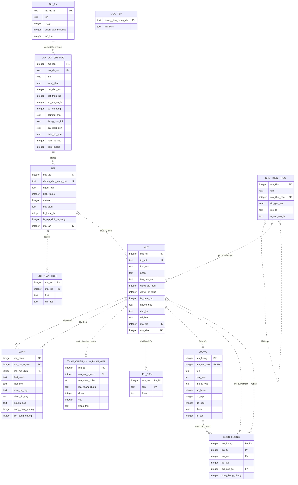

# Mô hình dữ liệu NexGraph

NexGraph dùng Graph v7, App v3, graph chung v1 và kho cấu hình của host. Xem [kiến trúc](architecture.md) để theo dõi luồng dữ liệu giữa host, engine và MCP. Các bản thiết kế CSDL từ Sprint 2 được giữ làm lịch sử.

## Graph v7 theo từng dự án

`graph.db` mặc định ở `<project>/.nexgraph/graph.db`. Nếu dự án không dùng được chỗ này, registry có thể đặt DB ở `<engine-data>/projects/<projectId>/graph.db`. Mỗi DB chứa tối đa một hàng `du_an`. Khi mở DB để ghi, engine bật WAL và khóa ngoại, đồng thời có migration 1→2→3→4→5→6→7. SQLite từ 3.43 hỗ trợ cấu hình FTS5 cần dùng. ERD biểu diễn bảng và khóa chính/ngoại. Các thuộc tính có ràng buộc duy nhất, mặc định, nullable hoặc trigger đối chiếu trong SQL. [Schema và trigger Graph v7](../../engine/src/nexgraph_engine/schema/graph.sql) · [Mở DB và nâng cấp](../../engine/src/nexgraph_engine/schema/db.py) · [Chọn chỗ lưu](../../engine/src/nexgraph_engine/store/projects.py)

Lượt lập chỉ mục đầy đủ dùng CSDL tạm riêng ở cùng thư mục. Chỉ khi hoàn tất, SQLite backup công bố toàn bộ đồ thị vào `graph.db` tại đường dẫn cũ. Các giao dịch đọc đang mở giữ snapshot ban đầu. `lan_lap_chi_muc` trong `graph.db` giữ lịch sử đã công bố. Trạng thái lượt đang dựng, lỗi và hủy được báo qua API job của engine. [Công bố SQLite](../../engine/src/nexgraph_engine/store/publication.py) · [API job](../../engine/src/nexgraph_engine/api/routes_projects.py)

- **Lượt và tệp.** Full index và refresh tạo lượt riêng. Một dự án chỉ có tối đa một lượt ở trạng thái chờ, cấu trúc hoặc phân giải. Tệp giữ đường dẫn tương đối với dấu `/`, SHA-256, kích thước, `mtime`, cờ test và mã lượt. Mỗi lỗi phân tích có loại riêng theo tệp. `moc_tep` là bản chụp đường dẫn và hash từ lần full index, vì vậy không có khóa ngoại tới các hàng tệp đang tồn tại. [Graph v7](../../engine/src/nexgraph_engine/schema/graph.sql) · [GraphStore](../../engine/src/nexgraph_engine/store/graph_store.py) · [So với mốc tệp](../../engine/src/nexgraph_engine/changes/baseline.py)
- **Nút và bằng chứng.** `ma_nut` là khóa SQLite, còn `id_nut` là định danh trả cho client, do engine tạo từ tệp, tên và loại theo quy ước. Node repository/directory không có `ma_tep`. Cạnh giữ hai khóa nguồn–đích, mức/điểm tin cậy, nguồn gốc và tùy loại có dòng bằng chứng bắt buộc. Khóa duy nhất của cạnh dựa trên nguồn, đích, loại, dòng và cột. `loai_con` là thuộc tính cạnh. `v_canh_bang_chung` suy ra tệp từ nút nguồn và `v_khoi_cap` suy ra cấp từ quan hệ cha. `INFERRED` là mức tin cậy của quan hệ tĩnh. Schema có sẵn loại `SEMANTIC_RELATED` và nguồn `llm`, còn pipeline lập chỉ mục hiện hành chủ yếu dùng AST và resolver. [Tạo ID](../../engine/src/nexgraph_engine/ids.py) · [Graph v7](../../engine/src/nexgraph_engine/schema/graph.sql) · [Phân giải tham chiếu](../../engine/src/nexgraph_engine/index/resolver.py)
- **Dữ liệu phục vụ truy vấn.** `nut_fts` là bảng ảo FTS5, ghép `rowid` với `ma_nut` ở lớp store. Nó lập chỉ mục nhãn, tên đầy đủ, chữ ký, tài liệu và từ khóa đã tách. Khối lưu là cụm kiến trúc, còn nhiều khung nhìn trên giao diện được dựng từ truy vấn. `luong` có một điểm vào duy nhất, lưu số bước/tệp, độ sâu, điểm và cờ bị cắt. `buoc_luong` lưu thứ tự và nút gọi nếu có. Thứ tự này mô tả phép duyệt tĩnh. [FTS và cột](../../engine/src/nexgraph_engine/schema/graph.sql) · [Tìm kiếm](../../engine/src/nexgraph_engine/store/search.py) · [Khung nhìn kiến trúc](../../engine/src/nexgraph_engine/arch/builder.py) · [Dựng flow](../../engine/src/nexgraph_engine/flows/build.py)
- **Bảng thêm ở v6 và v7.** v6 nới `CHECK` của `nut` cho năm loại nút mới (`type`, `variable`, `table`, `resource`, `config_key`) và thêm `lan_lap_chi_muc.gom_cau_hinh` cho tuỳ chọn "Tệp cấu hình". v7 thêm `nhan_cum` (tên cụm do AI hoặc người dùng đặt, khoá theo chữ ký thành viên), `ky_uc` (ký ức và đánh giá câu trả lời, `loai` ∈ `danh_gia|lesson|decision|incident|owner`, `nguon` ∈ `nguoi_dung|tro_ly|mcp`) và `bo_nho_dem_ngu_nghia` (cache kết quả gọi model theo khoá SHA-256). [Migration 5→6](../../engine/src/nexgraph_engine/schema/migrate_5_to_6.sql) · [Migration 6→7](../../engine/src/nexgraph_engine/schema/migrate_6_to_7.sql) · [Kiểm thử lược đồ](../../engine/tests/test_schema.py)

## Graph chung nhiều repo (global v1)

`<engine-data>/global.db` là CSDL riêng cho graph chung (W8, ADR 0010). Nó chỉ tham chiếu, không chép nút: `du_an_chung` giữ danh sách dự án thành viên (`ma_du_an` 36 ký tự, trùng id trong `app.db`), `canh_lien_repo` giữ cạnh nối hai dự án khác nhau với khoá ngoại tới `du_an_chung` và `ON DELETE CASCADE`. Mỗi lần một thành viên lập chỉ mục xong, engine tính lại toàn bộ cạnh liên repo; gỡ thành viên thì cạnh của nó mất theo. Cột `id_nut_nguon`/`id_nut_dich` là `id_nut` của từng `graph.db` thành viên, `loai_canh` chỉ nhận `CALLS` hoặc `REFERENCES`, mức tin cậy luôn `INFERRED`. [Schema global](../../engine/src/nexgraph_engine/schema/global.sql) · [Đăng ký graph chung](../../engine/src/nexgraph_engine/global_graph/store.py) · [Route global](../../engine/src/nexgraph_engine/api/routes_global.py)

## App v3 và phần được dùng lúc chạy

```mermaid
erDiagram
    DU_AN_DA_MO ||--o{ DONG_Y_GUI_DU_LIEU : "đồng ý theo dự án"
    KET_NOI_AI ||--o{ DONG_Y_GUI_DU_LIEU : "đồng ý theo kết nối"
    DU_AN_DA_MO ||..o{ PHIEN_CHAT : "phiên theo dự án"
    KET_NOI_AI |o..o{ PHIEN_CHAT : "kết nối được chọn"
    PHIEN_CHAT ||..o{ TIN_NHAN : "chứa tin nhắn"
    TIN_NHAN ||..o{ TRICH_DAN : "dẫn chứng"
    TIN_NHAN ||..o{ DOAN_MA_DA_GUI : "lưu vết gửi"

    DU_AN_DA_MO {
        text ma_du_an PK
        text duong_dan_tuyet_doi UK
        text ten
        text noi_luu
        integer mo_lan_cuoi
        integer da_go
    }
    KET_NOI_AI {
        integer ma_ket_noi PK
        text loai
        text ten_hien_thi
        text ten_agent
        text base_url
        text ten_model
        text muc_keychain
        integer la_mac_dinh
    }
    DONG_Y_GUI_DU_LIEU {
        text ma_du_an PK,FK
        integer ma_ket_noi PK,FK
        integer dong_y_luc
    }
    PHIEN_CHAT {
        integer ma_phien PK
        text ma_du_an FK
        integer ma_ket_noi FK
        text tieu_de
        integer tao_luc
        integer cap_nhat_luc
    }
    TIN_NHAN {
        integer ma_tin PK
        integer ma_phien FK
        integer thu_tu
        text vai_tro
        text noi_dung
        integer tao_luc
    }
    TRICH_DAN {
        integer ma_trich_dan PK
        integer ma_tin FK
        text duong_dan_tuong_doi
        integer dong_bat_dau
        integer dong_ket_thuc
        text trang_thai
    }
    DOAN_MA_DA_GUI {
        integer ma_doan PK
        integer ma_tin FK
        text duong_dan_tuong_doi
        integer dong_bat_dau
        integer dong_ket_thuc
        text ma_bam
    }
```

Schema App v3 nằm ở `<engine-data>/app.db`. `du_an_da_mo` lưu UUID, đường dẫn tuyệt đối, tên, chỗ lưu graph, lần mở gần nhất và trạng thái gỡ `da_go`. Gỡ dự án ẩn đăng ký khỏi danh sách và các truy vấn theo ID. Mở lại thư mục sẽ khôi phục đăng ký để dùng lại ID và graph. `ma_du_an` tương ứng UUID trong DB đồ thị. v3 thêm `ai_theo_du_an` (bật/tắt AI theo dự án, kiểu kết nối `direct|app`, nhãn model lúc bật, W9). Các bảng AI phía dưới được tạo theo schema Sprint 2. Tài khoản, consent và phiên Agent dùng các kho ở mục tiếp theo. [App v3](../../engine/src/nexgraph_engine/schema/app.sql) · [Di trú từ App v2](../../engine/src/nexgraph_engine/schema/migrate_app_2_to_3.sql) · [Registry](../../engine/src/nexgraph_engine/store/projects.py)

Các bảng kế thừa từ App v1 mô hình hóa các kiểu kết nối `acp` và `api_key`. Trigger kiểm thứ tự tin nhắn liên tục, giới hạn trích dẫn cho tin trợ lý và yêu cầu consent khi lưu vết đoạn mã của tin người dùng. Agent hiện hành kiểm consent trong `AccountService` và kiểm trích dẫn trong phiên. [Các ràng buộc SQL](../../engine/src/nexgraph_engine/schema/app.sql) · [Consent](../../apps/desktop/src/main/agent/accounts.ts) · [Kiểm trích dẫn](../../apps/desktop/src/main/ai/citations.ts)

## Các kho cấu hình và phiên đang dùng

`<host-data>` là `app.getPath('userData')` trong Electron và `globalStorageUri.fsPath` ở Code-OSS. `<engine-data>` mặc định là `<host-data>/engine-data`, có thể đổi bằng `NEXGRAPH_DATA_DIR`. Electron có thêm `NEXGRAPH_USER_DATA_DIR` để đổi gốc của host. Đường dẫn trong bảng là đường dẫn tương đối từ các gốc này. [Gốc Electron](../../apps/desktop/src/main/index.ts) · [Gốc Code-OSS](../../labs/extension/src/extension.ts#L121)

| Kho | Dữ liệu và cách dùng hiện tại |
| --- | --- |
| `<host-data>/prefs.json` | Provider tùy chỉnh, mô hình đang chọn, quyền gửi mã theo bộ dự án, mã nhà cung cấp và URL đích, cổng MCP HTTP và thư mục export theo dự án. Quyền theo host của phiên bản cũ cần xác nhận lại. Có di trú một lần từ `aiBaseUrl`, `aiModel` và khóa mã hóa cũ. [Tài khoản](../../apps/desktop/src/main/agent/accounts.ts) · [Thiết lập host](../../apps/desktop/src/main/ipc.ts#L42) |
| `<host-data>/ai-key.json` | Bản mã API key tra theo provider. Electron dùng `safeStorage`. Lớp Code-OSS dùng AES-256-GCM với khóa chủ trong `SecretStorage`. API key sau giải mã chỉ nạp vào model runtime. Renderer nhận trạng thái có key. [SecretStore](../../apps/desktop/src/main/ai/settings.ts) · [Tài khoản](../../apps/desktop/src/main/agent/accounts.ts#L165) · [Mã hóa Code-OSS](../../labs/extension/src/electron-host.ts#L24) |
| `<host-data>/mcp-keys.json` | Bản mã khóa MCP HTTP theo dự án. Khi host không có kho bí mật, khóa không được lưu xuống đĩa. MCP stdio và token của engine HTTP là hai đường tách biệt với khóa này. [Kho khóa MCP](../../apps/desktop/src/main/ipc.ts#L64) · [Quản lý MCP HTTP](../../apps/desktop/src/main/mcp-http.ts) |
| `<engine-data>/agent/oauth-secrets.json` | Bản mã credential theo provider qua `SecretStore`. Cập nhật token và đăng xuất được xử lý tuần tự. Tệp `auth.json` của bản cũ được xóa sau khi bản mã đã đọc lại thành công. Runtime dùng cấu hình model `<engine-data>/agent/models.json`. [Credential store](../../apps/desktop/src/main/agent/accounts.ts) |
| `<engine-data>/agent/sessions/<scopeId>/` | Phiên chat lưu trên đĩa dạng JSONL của pi: `index.json` giữ tên, phiên đang chọn, model và kết quả tác vụ; mỗi phiên một tệp `_<id>.jsonl`. `scopeId` là SHA-256 của bộ (dự án, gốc thư mục, provider, base URL, tài khoản), nên phiên tách theo dự án và tài khoản. Trạng thái chạy và quyết định duyệt vẫn chỉ sống trong bộ nhớ. Electron đóng phiên khi rời workspace nhưng không xoá tệp. [Kho phiên](../../apps/desktop/src/main/agent/session-store.ts) · [Phiên Pi](../../apps/desktop/src/main/agent/session.ts) · [Vòng đời workspace](../../apps/desktop/src/renderer/src/screens/WorkspaceScreen.tsx) · [Vòng đời extension](../../labs/extension/src/extension.ts) |
| `<engine-data>/transcripts/<projectId>/<sha>.txt` | Văn bản chép lời theo hash nội dung khi người dùng bật media và môi trường có công cụ cần thiết. Đây là cache tệp văn bản. [Chép lời](../../engine/src/nexgraph_engine/docs/media.py) · [Cấu hình đường dẫn cache](../../engine/src/nexgraph_engine/index/jobs.py#L116) |

## Di động và giới hạn hiện hành

- `graph.db` trong dự án có thể đi cùng thư mục. Khi mở bản sao đã di chuyển, registry thử đọc UUID trong graph, rồi cập nhật đường dẫn tuyệt đối trong App v3. DB đặt ở thư mục ứng dụng và cache media thuộc dữ liệu từng host. Khi sao lưu, đóng engine trước khi chép DB hoặc dùng cơ chế backup nhất quán của SQLite. [Registry](../../engine/src/nexgraph_engine/store/projects.py) · [Chế độ SQLite](../../engine/src/nexgraph_engine/schema/db.py)
- Electron và Code-OSS có gốc dữ liệu cùng cơ chế mã hóa riêng. Mã hiện tại chưa có tính năng chuyển credential và consent giữa hai host. Lịch sử chat lưu dạng JSONL trong `<engine-data>/agent/sessions/` (và `antigravity/sessions/` cho runtime Google), tách theo dự án và tài khoản; chưa có tính năng chuyển lịch sử giữa hai host. Việc chuyển credential là thay đổi thiết kế cần quy định migration và vòng đời dữ liệu trước khi triển khai. [Gốc Electron](../../apps/desktop/src/main/index.ts) · [Gốc Code-OSS](../../labs/extension/src/extension.ts#L121) · [Kho phiên](../../apps/desktop/src/main/agent/session-store.ts)
- Sơ đồ Sprint 2 và bộ SQL trong thư mục thiết kế ghi lại mô hình dự kiến thời điểm đó. Dùng SQL runtime và fixture migration để xác nhận phiên bản hiện hành. [Bản chuẩn hóa Sprint 2](../superpowers/specs/2026-10-24-nexgraph-csdl-chuan-hoa.md) · [SQL thiết kế](../../design/database) · [Kiểm thử lược đồ](../../engine/tests/test_schema.py)
