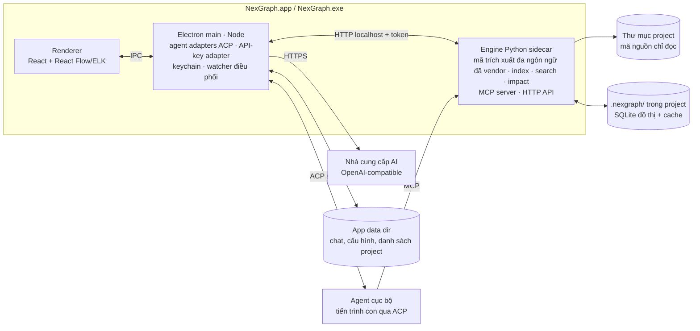

# NexGraph Desktop — Tài liệu thiết kế

> **Cập nhật phạm vi H0–H6, 2026-11-13:** bản này giữ thiết kế lịch sử; các mô tả ACP và song ngữ bên dưới không còn là hợp đồng bản bàn giao. Hiện chỉ adapter API key tương thích OpenAI, không streaming, không lưu lịch sử chat ra đĩa; ẩn chat giữ hội thoại/nháp, rời Workspace huỷ lượt đang chạy. Chỉ giao diện tiếng Việt, giữ thuật ngữ kỹ thuật tiếng Anh. Tour tất định, tính lúc gọi và không lưu. Nguồn sự thật là spec cùng tên trong workspace cha; kết quả kiểm chứng sau review ở `docs/benchmarks/2026-11-13-sua-sau-review.md`.

| | |
|---|---|
| Đề tài | Xây dựng nền tảng thông minh hỗ trợ phân tích, tìm kiếm và khám phá mã nguồn phần mềm |
| Sản phẩm | **NexGraph**: ứng dụng desktop (macOS + Windows) |
| Nhóm | Nguyễn Ngọc Tình (P1), Nguyễn Hoàng Tùng (P2), Võ Thành Đông (P3) |
| Ngày | 2026-10-18 |
| Nguồn quyết định | 4 vòng hỏi đáp với nhóm (2026-10-17 → 18) |
| Trạng thái | Chờ nhóm duyệt (đã qua 1 vòng review của builder) |

Quy ước: **[Nhóm]** là điều nhóm đã quyết. **[Đề xuất]** là lựa chọn của người viết spec, nhóm chưa xác nhận riêng và có thể đổi. Mục không gắn nhãn là hệ quả trực tiếp của các quyết định của nhóm.

---

## 1. Ý định

Lập trình viên khi vào một dự án lạ mất nhiều thời gian để hiểu: code nằm ở đâu, các phần nối với nhau thế nào, sửa chỗ này thì ảnh hưởng chỗ nào. Các công cụ hiện có mỗi cái giải một phần. Đa số là plugin cho AI agent hoặc CLI, không phải một ứng dụng để con người ngồi khám phá. Nhóm cũng phát hiện các điểm yếu cụ thể của chúng: phân tích Dart dùng regex, nhận định do LLM sinh không kèm bằng chứng, sơ đồ có mũi tên không được code ủng hộ.

NexGraph là **một ứng dụng desktop local-first** biến một thư mục mã nguồn thành knowledge graph. Người dùng có thể nhìn kiến trúc, khám phá, tìm kiếm, thấy vùng ảnh hưởng khi sửa code, và hỏi AI. Mọi câu trả lời của AI đều có trích dẫn kiểm chứng được. Điểm nhấn riêng: **hiểu sâu dự án Flutter/Dart**.

### 1.1 Mục tiêu theo thứ tự ưu tiên [Nhóm]
1. Đồ án đạt điểm cao, demo trơn tru trước hội đồng. Khoa chấm **sản phẩm và quy trình phần mềm**.
2. Sản phẩm open-source dùng được thật, làm portfolio.
3. Một chương đánh giá chất lượng/hiệu năng gọn và trung thực. Không phải đóng góp nghiên cứu.

### 1.2 Thành công trông như thế nào
Kịch bản demo 5 phút chạy trọn vẹn trên một project Flutter hội đồng chưa từng thấy [Nhóm]:
1. Mở app, chọn thư mục project.
2. Index xong, hiện **bản đồ kiến trúc**.
3. Hỏi "luồng đăng nhập chạy thế nào?". App tô sáng đường đi trên graph và mở code đúng dòng qua chip trích dẫn.
4. Sửa một hàm trong editor ngoài. App lập tức hiện **vùng ảnh hưởng** và **test liên quan**.
5. Chuyển sang slide số liệu đánh giá.

**Project demo [Nhóm]**: nhóm tự chọn trước một project Flutter hội đồng chưa thấy và index sẵn. Ngoài ra chuẩn bị phương án **index trực tiếp một project nhỏ** (tầng S) nếu hội đồng yêu cầu. Hệ quả:
- Bộ phân tích Flutter chỉ cần hỗ trợ chắc các API router có trong bộ project test + project demo.
- Với code lạ, app phải chạy được ở mức "graph chung" dù không nhận ra hết route (§6.3).

**Nguyên tắc phạm vi [Nhóm]**: tính năng không phục vụ kịch bản này thì để sau đồ án.

### 1.3 Không làm (non-goals)
- Không clone từ URL GitHub. Chỉ mở thư mục local [Nhóm].
- AI không sửa code, không chạy lệnh trên project. Chỉ đọc [Nhóm].
- Không làm web app, không có server/cloud của NexGraph, không tài khoản người dùng.
- Không làm nghiên cứu Task-Adaptive Context Retrieval như một đóng góp khoa học [Nhóm]. Ý tưởng có thể dùng trong cài đặt nhưng không đánh giá như nghiên cứu.
- Không cam kết cùng mức độ chính xác cho mọi ngôn ngữ trong MVP; chỉ Dart/Flutter là bắt buộc trước demo.
- Không có: video thuyết minh, cross-repo/cross-service linking, GitHub Action/PR comment, state management Flutter (Provider/Riverpod/BLoC). Có thể để hướng phát triển.

### 1.4 Thất bại dù "chạy được" (anti-goals)
- **Dùng subscription của người dùng bằng cách mượn OAuth client ID hoặc giả mạo app khác** [Nhóm]. Lý do: vi phạm điều khoản nhà cung cấp, rủi ro khoá tài khoản người dùng, dễ hỏng giữa demo, bị hội đồng chất vấn.
- AI trả lời mà không có trích dẫn, hoặc trích dẫn sai vẫn hiển thị như đúng.
- Mũi tên trên sơ đồ kiến trúc không có cạnh thật trong graph đứng sau.
- Gửi code lên cloud mà người dùng không biết.
- Telemetry ngầm.
- Báo cáo có trên 20% nội dung sao chép. Theo quy định khoa là 0 điểm.

---

## 2. Ràng buộc

| Ràng buộc | Giá trị |
|---|---|
| Thời gian | **10 tuần** theo thông báo của khoa: tuần 1 (12–18/10/2026, chọn đề tài, mô tả, thiết kế giao diện) → tuần 10 (14–20/12/2026). Nộp báo cáo trên LMS 21–27/12/2026 (kèm bản scan phiếu tiến độ có chữ ký GVHD); bảo vệ trước hội đồng 28/12/2026–10/01/2027 |
| Nhóm | 3 người, đều full-stack [Nhóm] |
| Máy | P1 có Mac + Win; hai người còn lại dùng Win [Nhóm] |
| Hệ điều hành mục tiêu | macOS và Windows, cả hai bắt buộc [Nhóm] |
| Ngôn ngữ phân tích | **Dart/Flutter ưu tiên 1 (MVP, demo)**. Ưu tiên 2: TypeScript/JavaScript (NestJS, React), C# (ASP.NET Core MVC + Razor), Python. Ưu tiên 3: HTML/CSS. Làm sau khi MVP ổn định; mỗi ngôn ngữ kiểm thử trên một dự án thật của nhóm (xem báo cáo tuần 1, Bảng 1.2) [Nhóm, cập nhật 2026-10-18] |
| AI | Agent có sẵn trên máy (chạy qua ACP) + API key tương thích OpenAI. Mọi tính năng lõi chạy không cần AI [Nhóm] |
| Báo cáo | 40–50 trang không kể phụ lục. Chương 3 (thực nghiệm) chỉ 3–10 trang nhưng phải có hồ sơ thiết kế UML. Times New Roman 13, giãn dòng 1.5 (theo `[4] Huong dan viet DACN`) |
| Tiến độ | Phiếu theo dõi có 12 dòng tuần, GVHD ký mỗi tuần. Tuần 8 (30/11–6/12) GVHD đánh giá % hoàn thành và quyết định có được tiếp tục |
| License | Repo public từ đầu, **Apache-2.0** [Nhóm] |

---

## 3. Người dùng và tác nhân

- **Người dùng chính**: lập trình viên mới vào một dự án lạ, cần hiểu nhanh (onboarding) [Nhóm].
- **Người dùng phụ**: lập trình viên đang sửa code, cần biết vùng ảnh hưởng [Nhóm].
- **Tác nhân ngoài**:
  - AI agent bên ngoài truy vấn graph qua MCP
  - Agent cục bộ được NexGraph điều khiển qua ACP
  - Nhà cung cấp AI (API)

### 3.1 Use case [Nhóm]
| ID | Use case | Tác nhân |
|---|---|---|
| UC01 | Mở project & index | Lập trình viên |
| UC02 | Xem bản đồ kiến trúc | Lập trình viên |
| UC03 | Khám phá graph | Lập trình viên |
| UC04 | Tìm kiếm | Lập trình viên |
| UC05 | Xem code của node | Lập trình viên |
| UC06 | Xem vùng ảnh hưởng khi sửa code | Lập trình viên |
| UC07 | Hỏi đáp với AI | Lập trình viên, Agent cục bộ / Nhà cung cấp AI |
| UC08 | Cấu hình kết nối AI | Lập trình viên |
| UC09 | Guided tour | Lập trình viên |
| UC10 | Agent ngoài truy vấn graph qua MCP | AI agent bên ngoài |
| UC11 | Xuất sơ đồ/báo cáo | Lập trình viên |

Đặc tả chi tiết từng UC viết trong SRS. Ai làm phần nào viết UC phần đó.

---

## 4. Phạm vi tính năng [Nhóm]

| Mức | ID | Tính năng | UC |
|---|---|---|---|
| **Bắt buộc** | F1 | Mở thư mục, index có tiến độ, tự cập nhật khi file đổi | UC01 |
| | F2 | Bản đồ kiến trúc theo module/community; mỗi mũi tên có bằng chứng | UC02 |
| | F3 | Graph explorer: zoom, lọc, inspector node, mở code đúng dòng | UC03, UC05 |
| | F4 | Tìm kiếm symbol/từ khoá | UC04 |
| | F6 | Theo dõi Git working tree → vùng ảnh hưởng + test liên quan | UC06 |
| | F8 | MCP server cục bộ. Đã nâng lên bắt buộc vì là cầu nối AI ↔ graph | UC07, UC10 |
| | FL | Hiểu Flutter: cây widget, route giữa màn hình, dependency `pubspec.yaml` | UC02, UC03 |
| **Nên có** | F5 | Hỏi đáp AI có trích dẫn file:dòng | UC07, UC08 |
| | F7 | Guided tour cho người mới (định nghĩa bên dưới) | UC09 |

**F7 – Guided tour** [Đề xuất]:
- **Tất định, không cần AI.** Tour gồm 5–10 bước sinh từ graph:
  1. Entry point (`main()` / `runApp`)
  2. Các màn hình theo route
  3. Các module/community lớn nhất theo độ trung tâm
  4. Các node có nhiều phụ thuộc nhất
- Mỗi bước: camera di chuyển tới vùng graph, mở code, kèm mô tả sinh từ template.
- Có adapter AI thì AI chỉ viết lại lời mô tả cho tự nhiên hơn. Thiếu AI tour vẫn chạy.
- Phần việc: P2 làm UI tour; P1 cung cấp API "các bước tour".
| **Có thì tốt** | F9 | Xuất PNG/Markdown | UC11 |

---

## 5. Kiến trúc

### 5.1 Mô hình tiến trình [Nhóm]



- **Renderer** (React): chỉ giao diện, không truy cập file hay mạng trực tiếp.
- **Electron main** (Node): vòng đời app; spawn và giám sát engine; adapter ACP cho agent; adapter API key với vòng tool-calling; lưu secret trong keychain hệ điều hành.
- **Engine** (Python, đóng gói kèm app thành binary sidecar): parse, index, lưu trữ, search, impact, kiến trúc, MCP server. Đây là nơi duy nhất cài thuật toán. Mọi client (UI, MCP, chat) gọi cùng engine.
- Giao tiếp main ↔ engine: HTTP trên `127.0.0.1`, cổng ngẫu nhiên, token sinh mỗi lần khởi động [Nhóm].

### 5.2 Engine: mã trích xuất đa ngôn ngữ đã vendor
- Mã trích xuất đa ngôn ngữ được chép nguyên vào repo (vendor), **ghim một commit**, không đồng bộ với nguồn gốc (nguồn gốc đổi rất nhanh). Giấy phép và thông báo ở `NOTICE`.
- Giữ: `detect → extract → build → cluster → analyze`, cache AST, resolver registry.
- Bỏ/tạm hoãn: 16 bản skill/installer, video/transcribe, Neo4j/FalkorDB, Google Workspace, phần lớn backend LLM của mã vendor. Phần LLM của NexGraph nằm ở Electron main, không dùng `llm.py`.
- Tách engine truy vấn khỏi `serve.py` thành module riêng. Output là JSON có cấu trúc (node id, điểm, hop, lý do).

### 5.3 Schema dữ liệu

**Node**:
- `id` có cấu trúc, tương đối với root: `{rel_path}::{Qualified.Name}#{kind}`
- `kind`, `label`, `qualified_name`, `file_type`, `source_file`
- `line_start`, `line_end` (bắt buộc với code)
- `language`, `is_test`, `community`, `origin ∈ {ast, resolver, llm}`

**Edge**:
- **Cho phép nhiều cạnh giữa cùng cặp node** (không dùng `nx.Graph` vì nó chỉ cho một cạnh giữa mỗi cặp node)
- `type` thuộc enum lõi khoảng 12 loại (`CONTAINS, DEFINES, CALLS, IMPORTS, INHERITS, IMPLEMENTS, REFERENCES, USES_TYPE, TESTED_BY, DOCUMENTS, DEPENDS_ON, SEMANTIC_RELATED`); `subtype` giữ relation gốc
- `confidence` + `confidence_score`, `origin`
- `evidence {file, line}`

**Bổ sung cho Flutter**:
- `kind`: `widget`, `screen/route`, `package`
- cạnh: `COMPOSES` (widget chứa widget), `NAVIGATES_TO` (route), `DEPENDS_ON` (pubspec)

Tên chính xác của các enum này để builder chốt.

**Lưu trữ**:
- **SQLite là kho truy vấn chính**: nodes, edges, FTS5, metadata, commit SHA của lần index.
- NetworkX chỉ nạp subgraph khi cần tính toán.
- `graph.json` chỉ còn là định dạng xuất [Nhóm: Q8, Q7b].

### 5.4 Phân tích Dart/Flutter [Nhóm]
- **Dùng Tree-sitter thay extractor Dart dạng regex.** Grammar Dart: `tree-sitter-dart` (đã kiểm khả thi, ghim 0.1.0; xem ADR 0006).
- Trích: class/mixin/enum/extension, hàm/method, import/export/part, lời gọi.
- **Đặc thù Flutter**:
  1. **Cây widget**: widget nào tạo widget nào trong `build()`.
  2. **Route**: định nghĩa route (`MaterialApp.routes`, `onGenerateRoute`, `GoRouter`…) và lời gọi điều hướng (`Navigator.push*`, `context.go/push`…) → cạnh màn hình → màn hình. Các API router được hỗ trợ cụ thể chốt sau khi xem bộ project test.
  3. **`pubspec.yaml`**: node package + cạnh dependency.
- Test Dart: file trong `test/`, `integration_test/` → `is_test`, sinh `TESTED_BY`.
- Python: dùng extractor có sẵn của mã vendor, bổ sung `kind/line_end/is_test`.

### 5.5 Index
- **Hai pha**:
  - Pha 1, cấu trúc: file, symbol, contains, import. Xong là UI dùng được ngay.
  - Pha 2, phân giải lời gọi và các cạnh suy luận: chạy nền, UI cập nhật dần.
- **Parse song song nhiều tiến trình** + cache theo hash nội dung. Lần sau chỉ xử lý file đổi.
- Tôn trọng `.gitignore`; bỏ file sinh tự động (`*.g.dart`, `*.freezed.dart`…), minified, vendored, `build/`, `.dart_tool/`. Monorepo: cho chọn package cần index.
- Huỷ được giữa chừng. Project quá lớn thì cảnh báo trước.

### 5.6 Theo dõi thay đổi & vùng ảnh hưởng (F6)
- Watcher file → re-index tăng dần file đổi.
- `git diff` working tree so với `HEAD` → hunk → node theo `line_start/line_end` .
- Lan truyền có trọng số theo loại cạnh, có hướng, có decay và giới hạn độ sâu/số node. Tham số ban đầu: `CALLS 1.0, INHERITS 0.9, TESTED_BY 0.7, IMPORTS 0.5`, decay 0.6, depth 2), tinh chỉnh trên bộ dev.
- Test liên quan: `TESTED_BY` trực tiếp + test của caller trong ≤2 hop. Hàm đổi mà không có test nào thì đánh dấu "test gap".
- Chỉ đọc Git, không bao giờ ghi.
- **Project không phải Git repo** (ví dụ file zip) [Đề xuất]: vẫn mở được. F6 chuyển sang so với **trạng thái của lần index gần nhất** (dựa trên hash nội dung file), UI ghi rõ "không có Git: so với lần index trước".

### 5.7 Bản đồ kiến trúc (F2)
- Gộp graph theo thư mục/module/community thành các khối ≤ khoảng 9–12 khối mỗi màn. Bấm khối để đi sâu.
- Mũi tên giữa khối = tổng hợp cạnh IMPORTS/CALLS thật. **Không có cạnh thật thì không vẽ.** Bấm mũi tên → danh sách call site (file:dòng).
- Không cần AI. Khi có AI, AI chỉ đặt tên khối và viết mô tả, không quyết định mũi tên.

### 5.8 Tích hợp AI [Nhóm]

**Adapter A: agent cục bộ qua ACP**
- Một adapter ACP duy nhất. Hỗ trợ **một agent cục bộ trước** (chạy ở chế độ ACP); các agent ACP khác làm sau nếu kịp.
- **Ghim và kiểm thử với một phiên bản agent cụ thể**, ghi vào tài liệu cài đặt. Cờ dòng lệnh thay đổi giữa các phiên bản, đó là lý do chọn ACP thay vì gọi CLI với cờ.
- Truyền MCP server của NexGraph vào phiên ACP khi tạo session. Không sửa config của người dùng.
- **Chính sách quyền chỉ đọc**: NexGraph trả lời mọi yêu cầu cấp quyền của agent. Từ chối ghi file, sửa file, chạy lệnh shell. Cho phép đọc file trong project và gọi tool MCP của NexGraph. Không bao giờ bật chế độ tự duyệt.
- **Ép chỉ đọc ở hai lớp** [Đề xuất]: Agent có thể tự duyệt một số thao tác theo config riêng của người dùng, nên không thể chỉ dựa vào việc trả lời yêu cầu ACP.
  - Lớp 1: khi spawn agent ở chế độ ACP, truyền config qua biến môi trường cấu hình của agent. Config này định nghĩa một agent cấm `edit`/`write`/`bash`. File config của người dùng không bị sửa.
  - Lớp 2: từ chối mọi yêu cầu ghi/chạy lệnh đến qua ACP.
  - **Spike ở tuần 2** để xác minh thứ tự ưu tiên khi gộp config của agent. Nếu không đảm bảo được chỉ đọc: agent được ghi rõ là "chế độ hạn chế yếu" trong UI, và **adapter B trở thành đường chính** cho F5.
  - **Kết quả spike (2026-10-27): không đảm bảo được.** Xem ADR 0004; agent cục bộ ở "chế độ hạn chế yếu", adapter B là đường chính, ghim phiên bản agent đã kiểm thử.
- Provider/model (gồm cả provider tuỳ chỉnh) do người dùng cấu hình trong agent. NexGraph không quản lý.

**Adapter B: API key tương thích OpenAI**
- Cấu hình base URL + API key + model. Phủ được các dịch vụ đám mây và mô hình chạy trên máy có endpoint tương thích.
- NexGraph tự chạy vòng tool-calling với **cùng bộ tool** như MCP.
- Key lưu trong keychain hệ điều hành.

**Chung cho cả hai**
- Không có adapter nào thì F5 tắt; mọi tính năng khác vẫn chạy.
- **Minh bạch dữ liệu**: trước lần gọi AI đầu tiên của mỗi project, hiện thông báo rằng đoạn code sẽ được gửi tới agent/nhà cung cấp nào. Có thể xem nội dung đã gửi.
- **Trích dẫn**: AI phải trả trích dẫn dạng `path:start–end`. App kiểm tra file tồn tại và khoảng dòng hợp lệ. Hiển thị thành chip bấm được (mở code + tô node). Trích dẫn không hợp lệ thì gạch và gắn nhãn "chưa xác minh" [Nhóm].
- **Bộ tool MCP** (tên và tham số cụ thể để builder chốt): tìm kiếm; lấy node; lấy láng giềng theo loại cạnh/hướng/độ sâu; lấy vùng ảnh hưởng của file/symbol; lấy bản đồ kiến trúc; đọc đoạn code theo file + khoảng dòng; **truy vết luồng** (từ một node/entry point đi theo `CALLS`/`NAVIGATES_TO`/`COMPOSES`). Output có giới hạn kích thước và báo khi bị cắt.
- **Hai cách chạy MCP** [Đề xuất]:
  1. **Trong app**: dùng cho agent mà NexGraph tự điều khiển. Truyền qua ACP lúc tạo session.
  2. **Độc lập qua stdio** cho agent bên ngoài (UC10), chạy được cả khi app đóng: `nexgraph-engine mcp --project <đường dẫn>`. Cùng binary engine, đọc SQLite của project đã index ở chế độ chỉ đọc (WAL cho phép app ghi song song).
  
  Settings có nút **"Sao chép cấu hình MCP"** cho agent bên ngoài hỗ trợ MCP. Hệ quả: binary engine phải chạy được như CLI riêng. Sơ đồ tuần tự "agent ngoài gọi MCP" vẽ theo đường stdio.
- **Tô sáng luồng trên graph (bước 3 của demo)** [Đề xuất]: app không vẽ theo lời AI.
  - Trích dẫn hợp lệ → ánh xạ sang node theo file + khoảng dòng.
  - App tìm đường nối các node đó **chỉ qua cạnh thật** (`CALLS`, `NAVIGATES_TO`, `COMPOSES`, tối đa ~4 hop giữa hai node liên tiếp).
  - Có đường → tô node + cạnh. Không có đường → chỉ tô node, không vẽ mũi tên, ghi chú "không tìm thấy liên kết trực tiếp trong graph".
  - AI được khuyến khích gọi tool truy vết luồng để câu trả lời bám theo đường có thật ngay từ đầu.
- Không dùng mã đăng nhập OAuth của bên thứ ba.

### 5.9 Giao diện [Nhóm]

Bố cục kiểu trình soạn thảo mã:

```
┌──┬──────────────┬──────────────────────────────┬─────────────┐
│Ex│ Explorer     │ [Kiến trúc][Graph][Flutter]  │  AI Chat    │
│Se│ / Search     │ [login_screen.dart ×]        │  (Cmd/Ctrl+L│
│Ch│ / Changes    │                              │   thu gọn)  │
│To│ / Tour       │     vùng hiển thị chính      │  chip trích │
│  │              │     + inspector nổi          │  dẫn        │
├──┴──────────────┴──────────────────────────────┴─────────────┤
│ status: index 100% · agent cục bộ · HEAD a1b2c3d         │
└──────────────────────────────────────────────────────────────┘
```

Màn hình:
1. **Projects**: danh sách project đã mở, "Mở thư mục".
2. **Indexing**: tiến độ, thống kê, nút huỷ.
3. **Workspace**: như hình trên. Activity bar gồm Explorer, Search, Changes, Tour. Vùng giữa có tab Kiến trúc / Graph / Flutter, file code mở thành tab riêng. Cột phải là chat AI. Inspector nổi khi chọn node.
4. **Settings**: chọn agent/API key, kiểm tra kết nối, ngôn ngữ.

Quy tắc:
- Graph render bằng **React Flow + ELK**, (tự dựng, dùng thư viện mã nguồn mở).
- **Không bao giờ vẽ cả graph.** Tab Graph hiện vùng lân cận node đang chọn, tối đa khoảng 2.000 node; vượt thì gộp.
- Song ngữ Việt/Anh, **mặc định tiếng Việt**. Thuật ngữ kỹ thuật giữ tiếng Anh [Nhóm].
- **Việc đầu tiên trước khi code UI: dựng mockup HTML bấm thử được** để nhóm chốt [Nhóm].

### 5.10 Nơi lưu dữ liệu [Nhóm]
Dữ liệu chia theo tính chất (đổi ngày 2026-10-24, xem ADR 0005):

- **Dữ liệu suy ra từ mã nguồn** (tệp, nút, cạnh + bằng chứng, cộng đồng, chỉ mục FTS5, hash tệp, bước tour, vùng ảnh hưởng): lưu trong **`.nexgraph/` ngay trong thư mục project**, một file SQLite.
  - Khi tạo thư mục, app ghi kèm `.nexgraph/.gitignore` chứa `*` để thư mục tự bị Git bỏ qua. **Không sửa `.gitignore` gốc** của project. Người dùng muốn đưa lên Git thì xoá file `.gitignore` bên trong; app cảnh báo rằng CSDL ghi lại mỗi lần lập chỉ mục nên không nên commit liên tục, và có lệnh xuất snapshot nén thay thế.
  - Chỉ dùng đường dẫn tương đối trong CSDL; có `schema_version`; định danh project là `project_id` ngẫu nhiên ghi trong CSDL (đổi tên hoặc di chuyển thư mục không mất index).
  - Engine và watcher **bỏ qua `.nexgraph/`**.
  - **Dự phòng:** thư mục project không ghi được (ổ chỉ đọc, thư mục hệ thống) thì lưu vào thư mục dữ liệu của app, mỗi project một thư mục con, và UI ghi rõ nơi lưu.
- **Dữ liệu cá nhân** (phiên chat, trích dẫn, cấu hình kết nối AI, danh sách project đã mở, tuỳ chọn giao diện): lưu trong thư mục dữ liệu của app (`%APPDATA%` / `~/Library/Application Support`), không bao giờ vào `.nexgraph/` vì có thể chứa đoạn code đã gửi cho AI. Secret nằm trong keychain, không vào CSDL.
- NexGraph **không sửa bất kỳ file mã nguồn nào** của project; thư mục `.nexgraph/` là ngoại lệ duy nhất app được ghi vào project.
- Có lệnh xuất `graph.json`.

---

## 6. Yêu cầu phi chức năng

### 6.1 Hiệu năng [Nhóm]
| Tầng | Ví dụ | Mục tiêu | Cam kết |
|---|---|---|---|
| **S** (≤1.000 file) | Project Flutter của lớp | Index lần đầu < 60 s; mở lại < 3 s | **Bắt buộc**; demo trên tầng này |
| **L** (5.000–15.000 file) | một project mã nguồn mở lớn (khoảng 5.000–15.000 file) chọn và ghim commit khi đo | Index lần đầu ≤ 10 phút; mở lại < 5 s; cập nhật sau khi lưu file < 2 s; RAM < 2 GB | **Đo và báo cáo trung thực ở tuần 8**, không cam kết đạt |

Chung:
- UI mượt với ≤ khoảng 2.000 node hiển thị.
- Bộ cài < 300 MB.
- Đo trên "laptop sinh viên". Cấu hình máy đo cụ thể ghi lại khi đo.

### 6.2 Bảo mật & riêng tư
- Không telemetry.
- Engine chỉ nghe `127.0.0.1` và yêu cầu token.
- Secret nằm trong keychain.
- Không sửa file mã nguồn của project; chỉ ghi vào `.nexgraph/` (§5.10).
- Code chỉ rời máy qua tính năng AI, có thông báo (§5.8).

### 6.3 Xử lý lỗi khi demo [Nhóm]
1. Không có agent/key: mọi chức năng trừ chat chạy bình thường, có hướng dẫn cấu hình.
2. Project quá lớn: cảnh báo, cho huỷ hoặc chọn thư mục con.
3. Project không phải Flutter: graph chung vẫn chạy, tab Flutter ẩn hoặc báo trống.
4. Mất mạng lúc demo: project đã index sẵn + video demo dự phòng.
5. Project không phải Git repo: vẫn mở; vùng ảnh hưởng so với lần index trước (§5.6) [Đề xuất].

Cả 5 kịch bản đều có test case trong test plan.

---

## 7. Đánh giá (chương thực nghiệm) [Nhóm]
1. **Độ chính xác graph Dart/Flutter**: gán nhãn tay trên 2–3 project (class, hàm, lời gọi, route, quan hệ widget). Đo precision/recall của NexGraph **so với extractor regex gốc của mã vendor**.
2. **Hiệu năng** theo hai tầng §6.1, trong đó một project mã nguồn mở lớn là project kiểm tra tải nặng.
3. **Khảo sát 5–10 bạn cùng lớp**: thời gian và độ chính xác khi trả lời vài câu hỏi về một project lạ, có và không có NexGraph. Kèm thang đo mức hữu ích.
4. **Bộ project** [Nhóm]: 2–3 project Flutter của lớp môn mobile (nhóm sẽ xin) + 1–2 app Flutter open-source cỡ vừa. Mỗi project ghim một commit. Project demo là project hội đồng chưa thấy.

---

## 8. Quy trình phát triển [Nhóm]
- **Scrum, sprint 1 tuần**, 9 sprint. Mỗi sprint có planning + review ngắn. Sprint review = một dòng trong phiếu theo dõi tiến độ, nộp GVHD ký.
- **GitHub Projects** quản lý backlog. Làm việc theo nhánh + **Pull Request**, mỗi PR ít nhất 1 người review.
- **GitHub Actions**: chạy test engine + app; build bản cài **macOS và Windows** mỗi lần merge vào nhánh chính.
- **QA Windows thật** mỗi cuối sprint (P3).

### 8.1 Phân vai [Nhóm]
| Người | Phụ trách |
|---|---|
| **P1 (Tình)** | Engine Python: mã trích xuất đã vendor, extractor Dart/Flutter Tree-sitter, schema + SQLite, index, impact. Build/CI macOS |
| **P2 (Tùng)** [Đề xuất; nhóm giao người viết spec chọn] | Frontend: Electron shell, React Flow/ELK, Workspace, Kiến trúc, Changes, Tour, i18n |
| **P3 (Đông)** [Đề xuất; nhóm giao người viết spec chọn] | AI & chất lượng: adapter ACP (agent cục bộ) + API key, MCP server, chat có trích dẫn; QA Windows, test plan, đo đánh giá |

Báo cáo: mỗi người viết phần mình làm (thiết kế, UC, kiểm thử tương ứng).

### 8.2 Lộ trình 9 tuần [Nhóm]
| Tuần | Ngày (giả định) | Mục tiêu | Kết quả kiểm chứng |
|---|---|---|---|
| 1 | 12–18/10 | Chọn đề tài; mô tả đề tài, đặc tả chức năng, mockup giao diện (báo cáo tuần 1) | Báo cáo tuần 1 nộp LMS |
| 2 | 19–25/10 | Repo + CI; vendor mã trích xuất, ghim commit; bản nháp SRS; **mockup UI**; khung Electron gọi được engine sidecar; spike Tree-sitter Dart; **spike ACP chỉ đọc** (§5.8) | App rỗng mở được trên Mac + Win, gọi được engine; kết luận spike ACP |
| 3 | 26/10–1/11 | Extractor Dart + schema mới; graph explorer cơ bản | Index một project Flutter của lớp, xem được graph |
| 4 | 2–8/11 | SQLite + tìm kiếm; bản đồ kiến trúc; CI build bản cài 2 OS | Bản cài tải từ CI chạy trên máy Win của P2/P3 |
| 5 | 9–15/11 | Watcher + diff → vùng ảnh hưởng + test liên quan; code viewer | Bước 4 của kịch bản demo chạy |
| 6 | 16–22/11 | Adapter ACP + API key; MCP; chat có trích dẫn | Bước 3 của kịch bản demo chạy |
| 7 | 23–29/11 | Flutter: widget, route, pubspec; guided tour. **Bản alpha** | Toàn bộ kịch bản demo chạy |
| 8 | 30/11–6/12 | **GVHD đánh giá %**. Đo đánh giá (§7), khảo sát, đo tầng L; sửa lỗi | Số liệu chương thực nghiệm |
| 9 | 7–13/12 | Viết báo cáo, vẽ UML; hoàn thiện UI | Bản nháp báo cáo đủ 4 chương |
| 10 | 14–20/12 | Bản cuối, slide, tập demo, video dự phòng | Hoàn tất 20/12; nộp LMS 21–27/12 |

---

## 9. Tài liệu bàn giao
Bộ chuẩn [Nhóm giả định; sẽ đối chiếu nếu khoa có mẫu riêng]:
- SRS
- Sơ đồ use case + đặc tả UC01–UC11
- Sơ đồ lớp
- Sơ đồ tuần tự cho các luồng: index project, hỏi AI có trích dẫn, vùng ảnh hưởng khi sửa code, agent ngoài gọi MCP
- Sơ đồ kiến trúc
- Schema dữ liệu
- Test plan + kết quả kiểm thử

**Ánh xạ vào báo cáo** (theo hướng dẫn của khoa):
| Chương | Độ dài | Nội dung NexGraph |
|---|---|---|
| 1. Tổng quan | 6–8 tr | Bài toán; các công cụ hiện có (tự viết lại từ 7 báo cáo, có trích dẫn); mục tiêu, phạm vi |
| 2. Cơ sở lý thuyết | 15–25 tr | Knowledge graph, phân tích tĩnh/Tree-sitter, thuật toán graph (community, lan truyền impact), MCP/ACP, kiến trúc Electron + sidecar |
| 3. Kết quả thực nghiệm | 3–10 tr | Kiến trúc, UML chính, giao diện, kết quả đánh giá §7 |
| 4. Kết luận | 1–2 tr | Kết quả, hạn chế, hướng phát triển |
| Phụ lục | — | SRS đầy đủ, đặc tả UC, test plan/kết quả |

**Đạo văn**: báo cáo nộp phải tự viết, trích dẫn nguồn theo quy ước của khoa.

Hình vẽ cho báo cáo dùng khổ A4. Phải kiểm tra font tiếng Việt có dấu trước.

---

## 10. License & ghi công [Nhóm]
- NexGraph: **Apache-2.0**. Giữ `LICENSE`, `NOTICE` và các tệp giấy phép của mã bên thứ ba đã vendor (`engine/third_party/`). Ghi chú "đã sửa đổi" trên file vendor bị sửa. Không dùng tên của mã vendor làm thương hiệu.
- Khi port mã từ bên thứ ba, ghi công trong `NOTICE` cùng PR.
- Không dùng mã đăng nhập OAuth của bên thứ ba.

---

## 11. Để builder tự quyết
Các lựa chọn sau không đổi những gì được xây, nên builder tự chọn và ghi lại:
- Công cụ build Electron (electron-vite/forge/builder), quản lý state React, thư viện i18n.
- Đóng gói engine (PyInstaller/Nuitka), web framework engine (FastAPI/Starlette).
- Tên/chữ ký chính xác của các tool MCP, endpoint HTTP, enum schema.
- Thư viện ACP client, thư viện keychain.
- Cấu trúc thư mục monorepo. Gợi ý: `apps/desktop`, `engine/`, `docs/`.
- Tham số lan truyền impact và ngưỡng gộp graph, chốt bằng dữ liệu bộ dev.
- Framework test cho từng phần.

---

## 12. Rủi ro và phương án dự phòng
| Rủi ro | Phương án |
|---|---|
| Đổi `nx.Graph` → đa cạnh làm vỡ nhiều chỗ trong mã vendor | Giữ phần cũ của mã vendor; dựng graph đa cạnh **riêng cho NexGraph** từ dữ liệu extraction trước bước gộp cạnh. Ghi vào SQLite |
| Đóng gói Python sidecar trên Windows (antivirus, SmartScreen) và macOS (Gatekeeper) khi chưa ký số | Kiểm tra bản cài trên máy Win thật từ tuần 4; tài liệu hướng dẫn mở app chưa ký; demo trên máy nhóm |
| Giao thức ACP hoặc agent cục bộ thay đổi | Ghim phiên bản; adapter API key làm đường dự phòng cho F5 |
| Tầng L quá chậm | Không cam kết; báo cáo nút thắt + hướng cải thiện |
| Grammar Dart Tree-sitter thiếu cú pháp mới | Test sớm ở tuần 2 trên project của lớp; ghi lại cú pháp không hỗ trợ |
| Thiếu project Flutter của lớp để test | Dùng app Flutter open-source thay thế |
| Trễ tiến độ trước mốc tuần 8 | Thứ tự cắt: F9 → F7 → state management (vốn đã ngoài phạm vi) → F5 chỉ giữ adapter API key |
